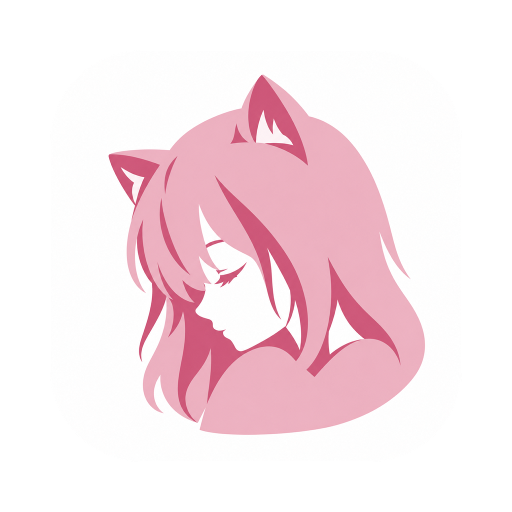
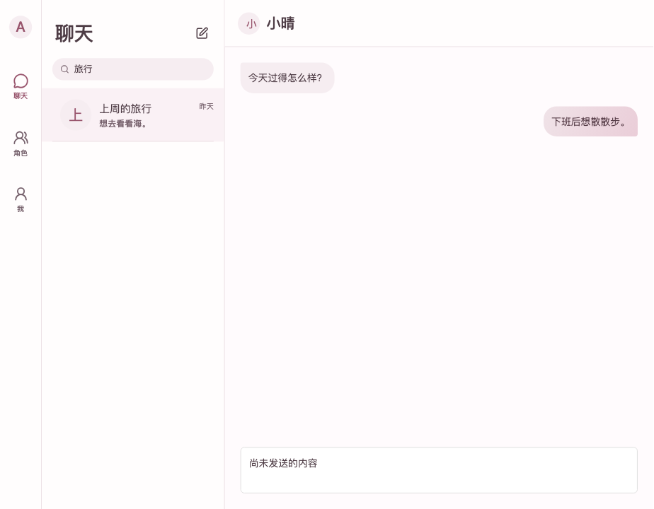
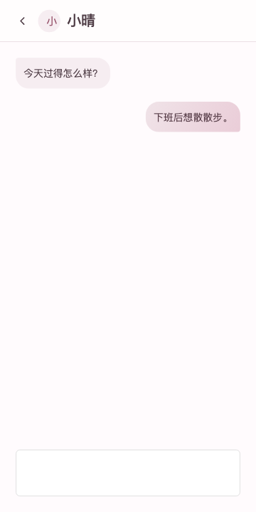
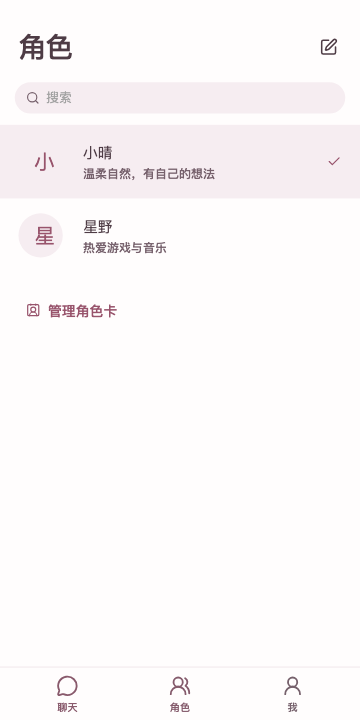

<div align="center">



# Aimy

**在电脑前，陪你聊聊今天。**

一款面向日常交流的桌面虚拟情感陪伴产品，正在准备内测。<br />
从日常聊天，到一起看视频、玩游戏，探索自然、可控、能延续的陪伴体验。


[界面预览](#界面预览) · [当前能力](#当前能力) · [开始开发](#开始开发) · [文档中心](docs/README.md)

</div>

---

Aimy 面向电脑前的日常交流与情感陪伴，当前状态为 **准备内测中**，以 macOS、一个主要角色和少量受邀用户为目标。桌面角色是陪伴的呈现方式，文字、声音、动作和情境理解共同构成体验。

**产品主工程是 [`aimy-app/`](aimy-app/)**，桌面入口为 `apps/stage-tamagotchi/`，包含桌面、聊天、模型服务、语音与角色能力。

## 界面预览

当前界面采用雾蒙粉主题，包含聊天、角色与“我”，支持宽窄窗口和头像编辑。

<p align="center">
  
</p>

<p align="center">
  
  
</p>

这些是当前真实组件的测试截图，消息和资料为合成示例，不代表真实模型回复。截图来源与验证范围见[10 月 20 日记录](docs/04-验证记录/2026-10-20-侧栏头像语音与雾蒙粉/README.md)。

## 当前能力

| 体验 | 当前进展 |
| --- | --- |
| 桌面角色 | 支持 Live2D / VRM 渲染、角色卡与设置，以及 VRM 手动挥手、点头、停止 |
| 文字与图片 | 文字与图片会话；已完成聊天界面改版、宽窄窗适配、头像编辑与跨窗口同步 |
| 语音交流 | 已接入连续聆听、单条语音、转文字与播报；角色和聊天共用麦克风开关，部分服务已有真实连通记录 |
| 授权看屏 | 麦克风与屏幕分别授权；已有实际取帧与视觉聊天记录，看屏和游戏入口集中在角色侧栏 |
| 记忆与回顾 | 已接入来源追踪、更新、纠正、删除、相关召回与回顾列表；真实效果仍在迭代 |
| 主动陪伴 | 已接入有界续聊计划、取消、防打扰时段和轮数限制；新增自动功能默认关闭 |
| 模型与数据 | 用户自行配置模型服务（BYOK），资料与会话本地保存；可按需使用本地或云端模型服务 |

“已接入”表示工程中存在实际消费链，不等于完整产品验收通过。当前仍有以下明确边界：

- **记忆效果：**10 月 16 日的首批 8 例真实模型验收暂未通过，日期、召回和部分流程问题仍待修复与复测。
- **语音与陪伴：**真实声音自然度、背景音下的打断、人物声画协调，以及完整陪玩／陪看旅程仍需持续体验验证。
- **发行：**当前正在准备内测。正式角色、音色、安装分发与更新源仍需单独验收。

完整范围见[累计功能清单](docs/00-当前方向/Aimy当前累计功能清单.md)与[当前项目状态](docs/PROJECT_STATE.md)。

## 最近更新

**2026-10-20 · 本机体验版 `0.12.0-beta.5+aimy.20261020.3`**

- 角色窗口右侧统一为单列侧栏，小窗口支持纵向滚动。
- 聊天与角色列表支持本地头像编辑、保存、恢复默认和同步。
- 角色与聊天共用语音开关，关闭时同步停止。
- 看屏与游戏入口移至角色侧栏，权限详情使用独立弹窗。
- 默认主题改为雾蒙粉，保留用户已主动选择的自定义颜色。

此前已完成聊天结构改版、语音服务适配、屏幕捕捉与视觉聊天验证，以及记忆和候选能力的有界接入。各批次结果分别保存在[验证记录](docs/04-验证记录/README.md)，历史通过项仅适用于对应版本和范围。

## 开始开发

当前核对环境为 **macOS / Apple Silicon、Node.js 24.20.0、pnpm 11.24.0**。项目采用 monorepo 工程结构，其他平台与可选工程不属于本轮验收范围。

```bash
git clone https://github.com/26YZT/aimy.git
cd aimy/aimy-app
pnpm install --frozen-lockfile

# 使用独立的开发资料目录启动桌面应用
APP_USER_DATA_PATH="$HOME/Library/Application Support/Aimy-Source-Dev" pnpm dev:tamagotchi
```

首次运行后，在应用中配置聊天模型及所需的语音／视觉服务。云模型按服务商规则计费，本地优先不等于所有推理都在本机执行。

常用命令均在 `aimy-app/` 执行：

| 目的 | 命令 |
| --- | --- |
| 桌面开发 | `pnpm dev:tamagotchi` |
| 桌面类型检查 | `pnpm --dir apps/stage-tamagotchi typecheck` |
| 桌面构建 | `pnpm build:tamagotchi` |
| Web 开发 | `pnpm dev:web` |

`pnpm dev` 默认启动 Web。首次全量安装、全部可选包和干净机器安装仍需单独验证。工程位置、工具版本与资料目录说明见[开发环境入口](docs/00-当前方向/开发环境与工程位置.md)。

## 隐私与控制

- 麦克风与屏幕采集独立授权，默认关闭；隐藏、最小化或退出时停止采集并拒绝迟到结果。
- 密钥通过应用配置，不放入仓库、静态前端或示例文件。
- 原始录音与截图默认不长期保存，聊天记录与长期记忆分别管理。
- 一期不包含摄像头、电脑代操作、外部发信或支付。

具体行为与仍待验证的范围以[当前方向与边界](docs/00-当前方向/开发方向与边界.md)为准。

## 工程与文档

```text
aimy/
├── aimy-app/              # 产品主工程
│   ├── apps/stage-tamagotchi/  # Electron 桌面入口
│   └── packages/              # 聊天、语音、角色、设置与共享能力
├── docs/                  # Aimy 第一方文档与验证记录
├── digital-lover/         # 旧独立样机，历史参考
└── THIRD_PARTY_NOTICES.md  # 第三方来源与许可入口
```

| 入口 | 内容 |
| --- | --- |
| [文档中心](docs/README.md) | 全部正式文档的统一入口 |
| [产品总纲与路线](docs/00-当前方向/产品总纲与当前路线.md) | 产品目标、体验地图与阶段边界 |
| [项目状态](docs/PROJECT_STATE.md) / [当前工作](docs/任务编排.md) | 已完成、未完成与接续范围 |
| [实施手册](docs/05-实施手册/README.md) | 具体批次的功能、技术与接口合同 |
| [验证记录](docs/04-验证记录/README.md) | 源码、自动化、桌面、真实模型与人测的分层证据 |
| [本次仓库同步检查](docs/91-管理记录/2026-10-21-GitHub仓库同步检查.md) | 检查结果、发布范围和本地保留项 |

旧样机、历史计划与候选研究仅用于定向追溯。它们不进入默认启动链，也不自动成为新需求。

## 许可与资源使用

软件版权、第三方来源与许可信息见[项目许可证](aimy-app/LICENSE)、[根第三方声明](THIRD_PARTY_NOTICES.md)与[产品第三方声明](aimy-app/THIRD_PARTY_NOTICES.md)。

角色、模型、字体、音色和 SDK 按各自许可使用，代码许可不代表资源获得统一再分发授权。
