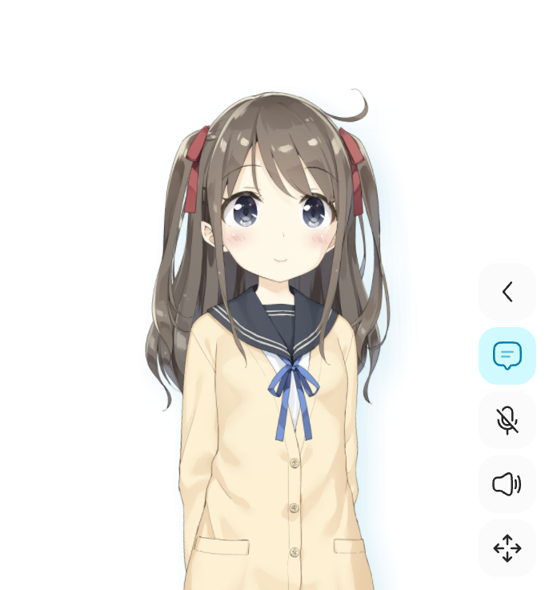
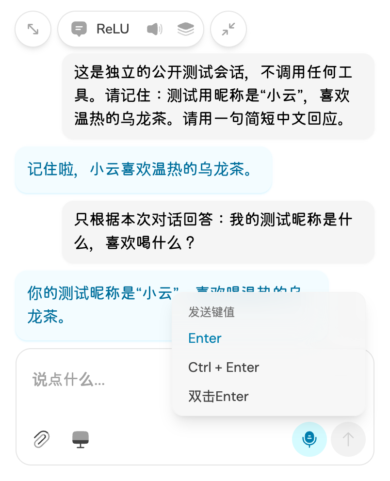
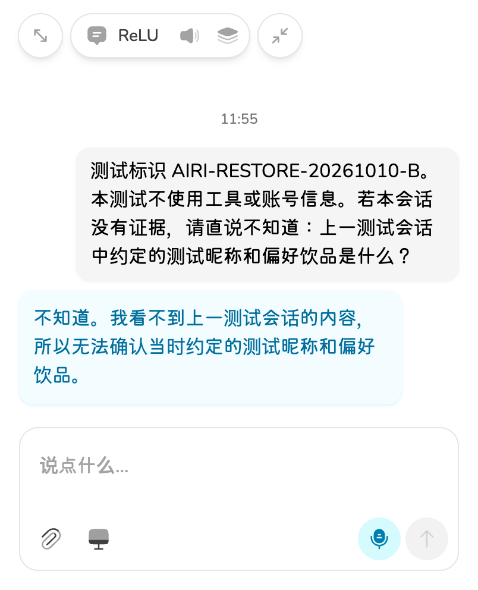

# AIRI 原版实测与 Aimy 能力差距

> 文档状态：定向调研参考，绑定当时来源；不是选型决定或实施授权。
> 产物时期：2026-10-10，正文明确日期。精确初稿时间未记录时保持未知。
> 保留原因：保留隔离原版来源指纹、文字实测、记忆负例、退出问题与未验边界。
> 上下文风险：第8节先做记忆/语音实验的接续建议已被同日更晚的直接继承→品牌→使用→优化顺序替代；不能据此阻塞原版继承；真实文字记录不代表多模态验收。
> 原位置：`digital-lover/docs/调研/2026-10-10-AIRI实测与能力差距.md`；归类整理：2026-10-11。
> 阅读入口：[文档中心](../README.md)。历史正文中的“当前、唯一、已锁定、下一步”仅适用于原时期。

日期：2026-10-10。目标：按用户要求，先运行原版、调查可复用项目，再决定 Aimy 增量。**AIRI 适合保留为界面、角色、对话和音频底座；用户最重视的长期记忆、自然插话和主动陪伴仍需补强及真实验收。**

本轮只修改 Aimy 文档与评估证据，没有改动原版或 Aimy 产品源码，没有集成新的记忆/语音框架。PRD 2.0 见[对齐草案](../00-当前方向/PRD-2.0-对齐草案.md)，尚未冻结。

## 1. 来源与运行范围

本轮新来源为 `/Users/mima1234/Documents/airi-main`，不与旧的 `aimy/airi-main` 混用。版本字段为 `0.12.0-beta.5`；目录没有 `.git`，无法确定上游 commit，也不能称为已核验的官方最新版。

在 `.baseline/airi-evaluation-2026-10-10/source` 创建隔离副本，排除 `.env` 和私人运行数据。对 6,214 个原始文件记录 SHA-256；树指纹为 `d0917b7ea0d3283ff969297ef4b3ad198e2b821a589561124d3e9227910c7eba`。构建后原目录与副本中的既有文件均无变动。父仓库暂存 index 指纹维持 `cfed2c524e1f382ac46018366c06887b298bb74f84d1ece2e8e7aee851745c49`。

评估采用独立临时 Electron 资料目录和本机调试端口；没有读取默认用户资料、密钥或已有会话正文。用户手动登录后明确授权“只用新建测试会话”，随后仅在两个新建会话发送三次公开测试请求。登录可能触发原版正常云同步，因此这不是离线产品验收。未读取登录服务的具体模型名称，不将回复归因于某个指定厂商。

没有开启真实麦克风、摄像头或屏幕采集。新测试会话的电脑操作工具均先关闭。截图只选取原版角色和公开测试内容，未复制登录 profile 或原始启动日志到文档。

## 2. 本轮实际结果

| 检查 | 实际结果 | 不能外推的结论 |
|---|---|---|
| 冻结锁文件安装 | 45/74 workspace 范围、依赖安装通过 | 不是全仓所有平台安装验收 |
| 桌面消费闭包构建 | 32 个 build 完成，Electron 启动成功 | 不是签名、公证或发行包验收 |
| 桌面类型检查 | `@proj-airi/stage-tamagotchi typecheck` 通过 | 不是所有 AIRI 包类型检查通过 |
| 定向原测试 | 6 文件、25 项通过 | repo 测试使用内存 driver；设备/模型自然度另验 |
| 原版界面与角色 | Live2D 示例成功渲染，两帧头部/嘴型不同；聊天、设置独立窗口可打开 | 没有实测 VRM 导入或声音/表情同步质量 |
| 真实中文文字 | 第一轮记住测试“小云/温热乌龙茶”；第二轮准确回答 | 三次测试不构成模型质量、性能或长历史评测 |
| 跨会话记忆 | 新建第二会话后，回复“不知道。我看不到上一测试会话的内容……” | 不能视为长期伴侣记忆已具备 |
| 跨进程记录 | 正常退出后新进程中，指定测试会话的单个 IndexedDB 键仍含测试标识；按指定 ID 加载后正文/回复回显通过 | 登录环境且原版 load 可补拉云消息；未完成全离线恢复或正常 UI 恢复验收 |
| 上次会话自动恢复 | 未自动回到刚新建的测试会话；第一次按原提示定位也未成功 | 不能报告“重启自动续聊通过”，也不能据此断言数据丢失 |
| 记忆管理页面 | 实际进入 `/settings/memory`，固定“正在开发中”提示可见 | 页面占位不等于记忆服务 |
| 实际最小化 | CDP 窗口诊断不支持 `Browser.getWindowForTarget`，未完成运行验收 | 最小化行为结论目前来自源码 |
| 退出与清理 | 前两次菜单退出返回0；最后清理时菜单退出及SIGTERM后进程仍在，只对测试PID强制终止 | 不能声明退出稳定性通过；具体原因待复核 |

本轮结束后已关闭测试浏览器会话并移除独立临时profile及认证日志，调试实例不再保留。未删除账号中的云端测试会话，没有操作已有云聊天。

自动化命令：

```sh
pnpm --filter @proj-airi/stage-tamagotchi... --filter @proj-airi/root install --frozen-lockfile --ignore-scripts --config.confirmModulesPurge=false
pnpm --filter @proj-airi/stage-tamagotchi exec install-electron
pnpm -r --filter @proj-airi/stage-tamagotchi... run build
pnpm --filter @proj-airi/stage-tamagotchi typecheck
pnpm --filter @proj-airi/stage-ui exec vitest run --project node src/database/repos/chat-sessions.repo.test.ts src/libs/audio/vad.test.ts src/workers/vad/vad.test.ts src/libs/speech/streaming-session.test.ts src/libs/speech/playback-speaking-state.test.ts src/stores/ai/chat-llm/streaming-control.test.ts
```

命令在隔离副本执行。第一次定向测试误用不存在的 project 名称，修正为配置原有的 `node` 后通过；没有修改配置或测试来消除失败。安装记录、构建记录及校验摘要见[机器记录](../04-验证记录/AIRI原版评估/2026-10-10-AIRI原版评估.json)。

## 3. 对照用户目标

| 目标 | AIRI 当前基础 | Aimy 需要做什么 |
|---|---|---|
| 原版界面、人物和文字聊天 | 已实跑；原版角色本身就是透明桌面窗口，聊天可悬浮/经典/折叠 | 保留；不要另做一套简单 UI。默认 Live2D/VRM 与正式角色另定 |
| 收起后持续动作与语音 | 折叠聊天不等于最小化角色。源码实际 minimize 会令 `stagePaused=true`；语音 host 独立 | 对齐窗口含义，验证后台声音与动画；不能把 computer-use desktop-overlay 当角色小窗 |
| 中文语音与自然音色 | ASR/TTS/provider 管线已有 | 配置兼容服务，真设备测中文、首声时间、音色自然度和回声 |
| 有效插话、避免误打断 | VAD 一过阈值即触发打断；有停止播放/取消/记录已播放片段链路 | 300ms 长度过滤发生在打断之后，不能证明能防短噪声/附和；需要中文与回声对照 |
| 说话、倾听和动作协调 | 口型、act/emotion 标签、音频时间线存在 | 实测标签/动作资源匹配与恢复；部分流式 special 会立即执行，不能当严格同步保证 |
| 长期记忆与人格 | 人格角色卡、当前会话上下文、IndexedDB 记录已有 | 用户事实抽取、跨会话检索、来源、纠正/删除、稳定关键事实读取未闭环 |
| 主动观察并回应 | devtools vision 有截图→理解→可选 context update | 没有验收观察→主动判断→生成→声音/动作全链路；安静/频率/成本需产品规则 |
| 15分钟低费用模式 | 原 ticker 默认3秒，设置范围0.5～15秒 | 需要新策略；采集频率、理解频率、开口频率分别设计，用户仍待选择含义 |
| 有依据地表达不同意见 | 通用模型可以生成反对意见 | 记忆矛盾要回到来源；限制频率、核查常识/攻略和不确定性，不能依赖一句人设提示 |
| 本地优先、权限与凭证 | 原版有账号/云同步及电脑操作入口 | Aimy 需重新核验默认开关、同步边界、凭证存储/日志和采集停止，不直接继承为产品承诺 |

## 4. 关键源码依据

以下路径相对于新来源 `/Users/mima1234/Documents/airi-main`，本轮只读复核。

- 窗口：`apps/stage-tamagotchi/src/main/windows/main/index.ts:82` 透明窗口；`:155` close 隐藏。`src/renderer/stores/stage-window-lifecycle.ts:20` minimize 暂停 stage；`pages/index.vue:447` 传递 paused。`pages/desktop-overlay.vue` 绘制电脑操作指针与边界，不是人物窗口。
- 插话：`packages/stage-ui/src/libs/voice/voice-activity-plugin.ts:58` 评分阈值即开始 input；`:90` 后置1200ms静音/300ms长度过滤。`packages/core-agent/src/voice/input/attempt.ts:240` 转写接受前已打断。`voice/controller.ts:180` 默认100ms fade 及中断记录。这些参数不是实测停止延迟。
- 表现：`packages/stage-ui/src/components/scenes/Stage.vue:265` act/emotion；`:383` 语音输出 host；`:464` paused 停口型 loop。`packages/pipelines-audio/src/speech-pipeline.ts:139` 时间线；`packages/core-agent/src/voice/output/response.ts:213` 流式 specials 路径。
- 观察：`apps/stage-tamagotchi/src/renderer/pages/devtools/vision.vue:47` 默认不发布 context；`:159` 定时采集理解；`:258` 页面卸载停止。`packages/stage-ui/src/stores/modules/vision/processing-store.ts:15` 默认3秒；`packages/stage-pages/src/pages/settings/modules/vision.vue:380` 频率范围。
- 存储：`packages/stage-ui/src/database/storage.ts` 的 `local:` 挂载 IndexedDB `airi-local`；`database/repos/chat-sessions.repo.ts` 存会话/索引/outbox/tombstone。`stores/chat/session-store.ts:341` 提交等待持久化；`:1375` 初始化恢复。
- 会话选择：新建抽屉 `components/scenarios/chat/components/sessions-drawer.vue` 用 `createSession(...,{setActive:false})` 后 `setActiveSession`；后者 `stores/chat/session-store.ts:1448` 只设置窗口选择并加载，未在该函数写持久索引。与本轮未自动回到新会话的现象相符，**属于待回归确认的原因推断，尚未修复**。
- 记忆：`packages/stage-pages/src/pages/settings/memory/index.vue`、`modules/memory-long-term.vue` 等为 WIP。Notebook 是 ref 数组；`text_journal` 只找到显示层，未找到桌面注册执行器。图片 journal 确有存储，但不等于用户事实记忆。`memory-pgvector` 入口仍占位；plast-mem 文档明确为 contract，不是 runtime 集成。

## 5. 需要优先处理的运行边界

原版 provider 配置含 `apiKey`，使用 localStorage 保存；登录后的配置同步路径会发送整体配置。MiniMax 配置验证失败路径还会把 providerConfig 传入 console.error。**这是源码风险，未读取任何真实凭证，也未触发该报错验证泄露。** 不应据此要求用户先填长期生产密钥，随后才补保护。

新会话“使用电脑”在源码默认 true，本轮也实际读到 true。测试时手动关闭；Aimy 一期明确后置电脑操作，产品基线需要默认关闭并验证模型不可自行开启。

原版会访问云服务/资源/更新地址，不能把独立本地 profile 当作零外发证明。安装构建会下载 Cubism 与示例素材；代码开源许可不替代角色、SDK、音色的发行许可。这里只做使用边界记录，正式资产仍需单独清单。

## 6. GitHub 调查如何用于开发

已查8类、深读5类，均固定 commit 并核对源码与许可证，详见[完整调查](2026-10-10-GitHub能力复用调查.md)。均未安装或运行，接入成本为工程推断。

- **记忆**：优先把 [Mem0 TS](https://github.com/mem0ai/mem0/blob/b7ad69afda6b6ed030347c66d48a13e4de9dec08/mem0-ts/package.json) 与 [MemOS 本地核心](https://github.com/MemTensor/MemOS/blob/a7367d07e55db61099f7b4e2c1108bc5831a24f3/apps/memos-local-plugin/README.md) 列为最小实验候选。前者自动ADD不等于自动纠正，删除历史仍可能含旧值；后者默认遥测/LLM日志需核验并关闭。尚未选型。
- **时间与来源**：[Graphiti](https://github.com/getzep/graphiti/blob/a9ef13f7e2cce23e92abd2f76947f42e270da25a/graphiti_core/edges.py) 有来源 episode 与有效期结构，适合学习事实变化；Python/图存储增加桌面部署负担。
- **语音**：[Pipecat](https://github.com/pipecat-ai/pipecat/blob/bbb2f6ba47ca61a06b04d6e84ae51fb3ac1436d1/src/pipecat/turns/user_start/min_words_user_turn_start_strategy.py) 可作为取消/turn策略对照，但 `split()` 英文计词示例不能直接套中文。先测 AIRI，避免直接换整套运行时。
- **观察**：[Screenpipe 当前许可](https://github.com/screenpipe/screenpipe/blob/d71eb3772355c6b5134fc737fae37520e9ec5cbc/LICENSE.md) 已不是可默认商业嵌入的 MIT；先学习事件采集方式，不直接打包。
- Letta 当前路线迁移、Memobase 来源保留与维护、LiveKit 独立模型许可也已记录，暂不据其宣传决定引入。

## 7. 后续中国区服务验证

用户表示可按需提供中国区服务，尚未向本轮提交 BYOK 密钥。文字已通过原版登录后的服务验证；具体模型未知，图片、语音尚未验证。

可先用两组兼容接口作候选：

| 能力 | 候选 | 原版适配与限制 |
|---|---|---|
| 对话/识图 | 百炼 `qwen3-vl-plus` | Chat/Vision 各自配置与激活；原版接受自定义模型和 image_url；工具、流式和图片实测待做 |
| 中文 ASR | 硅基流动 `FunAudioLLM/SenseVoiceSmall` | 可手填模型；是整段 WAV 的 HTTP 上传；先保持默认关闭 confidence/verbose_json 模式 |
| 中文 TTS | 硅基流动 `FunAudioLLM/CosyVoice2-0.5B` | 可手填完整 voice ID；自动列表可能筛不出来；原版按段等音频，不等于音频分块即时播放 |

以上依据厂商原文：[百炼视觉兼容接口](https://help.aliyun.com/zh/model-studio/qwen-vl-compatible-with-openai)、[硅基流动转写](https://docs.siliconflow.cn/docs/api/audio-transcriptions-post)、[硅基流动语音合成](https://docs.siliconflow.cn/docs/userguide/capabilities/text-to-speech)。模型可配置不等于账号已授权或自然度已达标，暂未测价格/成本，不据此承诺低价。

MiniMax 可作后续音色对照，但本地适配器虽然 `stream=true`，仍会收完整 SSE 再返回，且该 fetch 未转发取消 signal。中国区端点和模型须再按官方文档确认，不把它直接列为低延迟已通过方案。

## 8. 下一步

先完成 PRD 2.0 的三个选择和基线加固手册，再进行“中文长期记忆＋真实语音”的有界实验。主线始终保留原版界面和角色，依据实验决定局部复用。屏幕主动陪伴随后接入，不用观察频率设置掩盖记忆或语音体验问题。

未完成：真实声音/设备/图片/看屏、误打断率和延迟、后台最小化、退出稳定性、权限关闭负例、长期记忆方案运行对照、正式角色/音色/安装分发及人工体验验收。现有 Aimy 独立样机的831项测试不计入这份原版结果。

## 9. 公开测试画面






