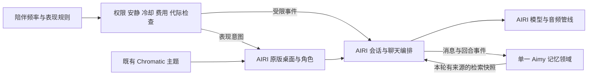

# 四个项目接入 AIRI 的复用价值与代码审查

> 文档状态：定向调研参考，绑定当时来源；不是选型决定或实施授权。
> 产物时期：2026-10-10，正文明确日期。精确初稿时间未记录时保持未知。
> 保留原因：保留四项目模块、接点、缺陷、许可、固定远端与本地匹配证据。
> 上下文风险：建议不等于用户已批准逐函数移植、进程、存储或角色方案；1435文件哈希核对不等于逐行人工审计。
> 原位置：`digital-lover/docs/调研/2026-10-10-四项目复用与代码审查.md`；归类整理：2026-10-11。
> 阅读入口：[文档中心](../README.md)。历史正文中的“当前、唯一、已锁定、下一步”仅适用于原时期。

日期：2026-10-10。对象：Ryza AI Revive、AionsHome、Kirara AI、Chromatic。接入基线是 `/Users/mima1234/Documents/airi-main`，版本字段0.12.0-beta.5；该原版目录无Git提交信息，本次另保存关键文件指纹。旧 `apps/aimy-desktop` 继续作为历史样机，不作为这次拼合目标。

**建议保留 AIRI 完整应用作为唯一底座，优先研究提取 AionsHome 的记忆能力，再借用 Ryza 的轻量记忆与表现规则；继续使用 AIRI 已有 Chromatic；Kirara 留作中期消息网关与工作流候选。四个项目都不适合整包叠加成第二套聊天内核。**

这里的“可以接入”表示存在可提取的实现或明确扩展点，不表示已经兼容、集成或运行验收。调查完成，产品代码未改，尚未选定新记忆框架、进程方案或数据库。原版继承和品牌定制仍按既定顺序推进，这些增量不成为其前置大工程。

## 1 项目总览与结论

| 项目 | 它实际是什么 | 对 Aimy 最有价值的增量 | 复用方式与结论 |
|---|---|---|---|
| **AionsHome** | Python/FastAPI + SQLite + 原生JS的完整自托管陪伴套件，另有Windows/Android宿主 | 有来源的长期记忆、检索、记忆管理与周期压缩；主动续聊和闲时行为 | **能力候选优先级最高。** 抽取记忆领域与调度规则，移除固定角色及无关集成。需要修删除竞态、关闭与访问控制，成本中到高 |
| **Ryza AI Revive** | 原生JS的Spine角色客户端，Electron/Android宿主，BYOK聊天/语音 | 轻量分层摘要、日期事实策略；说话/闲时的动作节奏与去重 | **适合作为策略和局部代码来源。** 记忆成本中；表现成本中且需角色映射。主动观察尚是计划项，语音不能直接替换AIRI |
| **Kirara AI** | Python多平台聊天机器人、可配置工作流和MCP客户端框架 | 未来外部消息入口、条件路由/工具编排、调用追踪 | **本轮不进入核心依赖。** 与AIRI已有provider/聊天链路重叠，AGPL需单独决策，工作流和记忆实现有缺陷，整服务接入成本高 |
| **Chromatic** | TypeScript调色库、UnoCSS预设和Vue演示站 | 品牌色、明暗主题、可选氛围色 | **AIRI已经接入。** 沿用现成依赖和主题入口，成本低；没有记忆、语音或主动陪伴能力 |

推荐组合是：**AIRI 原版桌面、角色、聊天和音频 + 一个可靠的 Aimy 记忆领域模块 + 受权限与频率约束的陪伴调度 + 既有 Chromatic 主题。** AionsHome与Ryza的记忆做法可以互补，但不能维护两份互相覆盖的“事实真相”。

## 2 来源与检查覆盖

四个URL均通过GitHub API现场核验，以下是本次冻结的默认分支提交。没有用星数判断代码质量。

| 来源 | 固定提交 | 最后提交日期 UTC | 与远端匹配的本地可比文件 |
|---|---|---|---:|
| [Ryza](https://github.com/zeroa234/ryza-ai-revive/tree/45e75ad6f6f0eb7952676b1bf24a674256082941) | `45e75ad6f6f0eb7952676b1bf24a674256082941` | 2026-10-05 | 87/87 |
| [AionsHome](https://github.com/death34018-hue/AionsHome/tree/c0d4c2e190ead5713f61d09ac572a641a0f5e727) | `c0d4c2e190ead5713f61d09ac572a641a0f5e727` | 2026-10-08 | 1,036/1,036 |
| [Kirara](https://github.com/lss233/kirara-ai/tree/8295a5deda0b289a3f70d946064b6c9a3e1b0753) | `8295a5deda0b289a3f70d946064b6c9a3e1b0753` | 2025-06-28 | 289/289 |
| [Chromatic](https://github.com/proj-airi/chromatic/tree/b5859e420de6006b458fcbb672136302ebe17eba) | `b5859e420de6006b458fcbb672136302ebe17eba` | 2026-08-03 | 23/23 |

合计1,435个源码、脚本、样式和HTML文件的Git blob SHA匹配，远端递归树均未截断。该口径包含部分vendor与测试，排除data、日志、依赖安装目录，不是1,435个文件逐行人工审计的声明，也不覆盖全部二进制资产。Kirara的本地快照虽然日期较早，仍与当前默认HEAD的可比源码一致。

已覆盖全仓模块、入口、依赖和测试分布，再追踪与Aimy有关的聊天、记忆、检索、删除、持久化、语音取消、主动调度和授权边界。行为检查使用已审阅函数和合成数据隔离复现。未读取个人聊天/密钥，未开启真实模型、麦克风、摄像头或桌面采集，未运行四套产品的完整体验。

## 3 四个项目的全局功能地图

### AionsHome

它提供聊天、语音、人物配置、长期记忆库与编辑、向量召回、显式记忆搜索、日/周等周期压缩、主动续聊、独立闲时状态和事件。还包含相册、日记、阅读、音乐、小游戏、多个角色/群聊，以及摄像头、手机活动、家居和外部服务集成。排除vendor/public/data等后，包含测试与Android重复资源的可读源码约28万行；这是大型应用集合，真实模块很多，但不应因为已有功能就全部纳入Aimy。

主要可提取代码：`aion-chat/memory.py`、`active_memory_search.py`、`memory_compression.py`、`memory_compression_scheduler.py`、`routes/memory_library.py`；主动续聊见`proactive_companionship.py`和`schedule.py`；闲时状态见`autonomy_state.py`等。它们直接依赖全局config、SQLite schema、WebSocket广播和固定角色，不能当作独立pip库直接接入。

向量存在SQLite BLOB中，召回在Python中读取并计算相似度，并非独立向量数据库服务。已有embedding接口不保证离线能力；普通召回在embedding失败时返回空，主动搜索另有文本后备。模型费用、维度切换、检索规模和中文准确率需实测。源码中的来源ID和压缩批次有价值，但还不能保证Aimy要求的纠正和彻底遗忘。

另一个可取的小能力是`expressive_voice.py`：先分离台词与说话方向，再添加受控语音标签，校验台词没有被改写。适合补到AIRI既有TTS前，成本低到中；实际音色/标签支持和自然度仍要按供应商验证。人格自动演化只宜参考为用户可审阅的建议，不迁入自动修改核心身份、权限或关系边界的行为。

原版安装/启动脚本与部分依赖偏Windows，requirements含`pywin32`。macOS需要重新划出消费闭包、移除平台功能或逐项适配。不得将摄像头、电脑活动采集、家居/购物、微信等功能随记忆模块默认带入。

### Ryza AI Revive

静态HTML与30个IIFE业务JS模块组成客户端；主要入口`web/index.html`、`web/js/app.js`。提供BYOK非流式聊天、TTS、浏览器/HTTP转写、Spine人物舞台、表情/口型/手势/视线、会话摘要和日期事实，以及世界地图、NPC、任务、体力/经济、每日奖励、语音缓存和服装导入。Electron构建配置主要针对Windows，另有Android原生闹钟。

源码有两层不同记忆：`memory.js`将回合逐级压成会话卡/总结卡；`longterm.js`维护digest、带日期/重要度/关键词的事实。后者是字面打分检索，没有embedding。当前记忆管理UI主要覆盖会话卡，并未完整覆盖长期事实；“启用会话总结”开关不能视为关闭全部记忆。

`config/layers.json`中的proactive、vision、vad、endpoint仍为planned；待机动作和闹钟不等于自然主动陪伴。人物表现细致，但骨骼与参数高度绑定Ryza资源。AIRI当前已有语音管线、provider和Spine导入，不能沿用该项目旧文档里对AIRI缺能力的判断。

### Kirara AI

核心是IM适配器→规则分发→工作流Block→模型/工具→消息发送。包括模型后端管理、Telegram/QQ/企业微信/HTTP适配、条件/循环工作流、MCP客户端、插件、媒体、追踪与管理API。源码包中的WebUI实际内容在运行时另从npm下载，这轮没有把那个独立前端算进代码审查。

它的MemoryManager主要保存最近100个会话条目，可按member/group/global及额外标识分区，持久化到JSON或Redis。这不是事实抽取、语义长期记忆或完整RAG。embedding/rerank接口存在，也不能据此声称已实现文档导入到引用的RAG闭环。

MCP模块是连接外部工具的**客户端**，不是可让AIRI直接连接并获得Kirara工作流的MCP服务端。工作流如果要给AIRI使用，还需专用桥接、取消和完成协议。当前不补齐人物、低延迟全双工语音或授权看屏。

### Chromatic

49个文件，两个发布包：`@proj-airi/chromatic`提供OKLCH色阶、颜色转换/混合和动态主题；`@proj-airi/unocss-preset-chromatic`提供CSS变量、工具类和亮度/饱和度修饰符。playground是Vue/Vite演示，含Three.js色彩空间组件。

[AIRI的UnoCSS配置](/Users/mima1234/Documents/airi-main/uno.config.ts:155)、[依赖catalog](/Users/mima1234/Documents/airi-main/pnpm-workspace.yaml:223)和[桌面主题更新](/Users/mima1234/Documents/airi-main/apps/stage-tamagotchi/src/renderer/App.vue:370)已实际接入。因此Aimy品牌定制可以直接沿用；无需再搬一个主题工程。README提及AIRI记忆数据库，是生态介绍，不能解释成Chromatic自身提供记忆。

## 4 与 AIRI 对接的实际边界

这是接入候选的责任分配，不是已冻结的新架构。

**记忆接在现有会话链路上。** [chat.ts](/Users/mima1234/Documents/airi-main/packages/stage-ui/src/stores/chat.ts:542)已装配会话和上下文端口，[消息/回合hooks](/Users/mima1234/Documents/airi-main/packages/stage-ui/src/stores/chat.ts:1049)可以用于候选抽取与观察。每条事实保留稳定ID、源消息、角色/用户归属、版本和有效状态。摘要是派生数据，不能删除或改写用户事实的唯一来源。

**检索快照必须属于本次请求。** [原版发送选项](/Users/mima1234/Documents/airi-main/packages/core-agent/src/runtime/chat-orchestrator-runtime.ts:122)已有`systemPromptSupplement`和取消signal；[chat.ingest](/Users/mima1234/Documents/airi-main/packages/stage-ui/src/stores/chat.ts:639)会捕获本轮选项。可以在这个边界准备检索结果，保持原有提示词并明确记忆是证据。不要把角色私有记忆直接写进跨会话共享context registry：[当前runtime会把registry快照汇总入prompt](/Users/mima1234/Documents/airi-main/packages/core-agent/src/runtime/chat-orchestrator-runtime.ts:881)，扩展时必须补请求/角色隔离与清理，不能仅凭contextId认定安全。

**主动行为接事件，不另起一个聊天系统。** 原版有[context/input协议](/Users/mima1234/Documents/airi-main/packages/plugin-protocol/src/types/events.ts:563)、[context bridge](/Users/mima1234/Documents/airi-main/packages/stage-ui/src/stores/mods/api/context-bridge.ts:43)和[SparkNotify表现接口](/Users/mima1234/Documents/airi-main/packages/stage-ui/src/stores/mods/api/spark-notify-reaction.ts:39)。AionsHome的NEXT_CHAT可以转换成“候选下一次联系时间”，经确定性规则检查后再发事件；关闭、用户新输入、换角色或退出时使旧候选失效。不能让模型自行打开采集或绕过安静模式。

**复用表现规则，保留现有渲染和音频。** 从Ryza提取动作去重、说话/空闲节奏、语义动作临时让位与语音风格规则，再映射到当前AIRI角色适配器。Spine骨骼名、官方动作数据、旧Turn/Voice/Api全局对象不跟随进入产品。

**只维护一套状态权威。** AIRI继续拥有会话、provider配置、音频取消和人物状态。记忆增量可以迁移纯函数/schema/测试到TS，也可以在有必要时评估裁薄的Python进程；后者需要额外生命周期、受限通信、打包和认证工作，本轮没有把它选成默认后端。复制两个Electron宿主、iframe整套WebUI、两套密钥设置或两套聊天记录都不属于推荐接法。

## 5 影响复用的主要代码问题

P1表示如果进入Aimy会损害权限、数据或主要体验；P2表示特定流程缺陷或使用限制。这是本次接入审查优先级，不是CVE评级。完整触发链和更多发现见各项目附录。

| 项目与优先级 | 已确认的问题 | 对复用的影响与证据 |
|---|---|---|
| Ryza P1 | 长期归纳返回时清空当前pending，模型等待期间的新对话被一起删除 | 已隔离复现；需冻结批次、串行化、版本检查。[longterm.js](/Users/mima1234/Documents/资料/ryza-ai-revive-master/web/js/longterm.js:279) |
| Ryza P1 | ASR缓存把块数当毫秒，整句话只发送最后22块 | 128样本/16kHz合成输入只送176ms；50ms测试块也仅1.1秒。实际设备采样率不同会改变时长，缺少整句累积的问题不变。[stt.js](/Users/mima1234/Documents/资料/ryza-ai-revive-master/web/js/stt.js:190) |
| Ryza P1 | 关闭麦克风后，在飞转写仍可回调并自动发送 | 已隔离复现；需取消signal、启停代际和发送门禁。[stt.js](/Users/mima1234/Documents/资料/ryza-ai-revive-master/web/js/stt.js:202) |
| Ryza P2 | “全部清除”没有删除语音/服装IndexedDB，长期事实也缺完整管理界面 | 数据清理语义不能原样迁移。[config.js](/Users/mima1234/Documents/资料/ryza-ai-revive-master/web/js/config.js:350) |
| AionsHome P1 | 压缩模型等待期间删除源记忆，返回后仍提交含该事实的active摘要 | 已用合成SQLite和实际函数复现；提交前须复查版本/删除状态，并清理派生链。[memory_compression.py](/Users/mima1234/Documents/资料/AionsHome-main/aion-chat/memory_compression.py:845) |
| AionsHome P1 | 默认监听0.0.0.0；设备审计只拦已blocked来源，设置API返回明文密钥字段 | 代码链路确认，未攻击真实服务；不能将审计通知当作认证。[main.py](/Users/mima1234/Documents/资料/AionsHome-main/aion-chat/main.py:640)、[settings.py](/Users/mima1234/Documents/资料/AionsHome-main/aion-chat/routes/settings.py:123) |
| AionsHome P2 | 关闭主动续聊只改布尔，现存timer触发路径没有重新检查开关 | 需取消旧任务并在执行前复核。[proactive_companionship.py](/Users/mima1234/Documents/资料/AionsHome-main/aion-chat/proactive_companionship.py:36) |
| AionsHome P2 | 切换embedding模型后旧向量没有provider/model/维度版本校验 | 可能静默失去召回或比较不同空间；需版本标记、重建与文本后备。[memory.py](/Users/mima1234/Documents/资料/AionsHome-main/aion-chat/memory.py:288) |
| Kirara P1 | 默认/示例JWT签名密钥可预测，首次设置密码未随机化 | 管理服务可达时密码不能保护token签名；需启动生成并拒绝默认值。[global_config.py](/Users/mima1234/Documents/资料/kirara-ai-master/kirara_ai/config/global_config.py:111)、[auth/routes.py](/Users/mima1234/Documents/资料/kirara-ai-master/kirara_ai/web/auth/routes.py:23) |
| Kirara P1 | query计算extra_identifier后仍遍历所有缓存，跨工作流读到历史 | 已隔离复现；不能原样作为角色/会话记忆隔离。[memory_manager.py](/Users/mima1234/Documents/资料/kirara-ai-master/kirara_ai/memory/memory_manager.py:100) |
| Kirara P1 | 正常stop不排空记忆持久化队列 | 已复现最后一笔未保存；冷启动clear也会直接return而保留磁盘历史。[persistences/base.py](/Users/mima1234/Documents/资料/kirara-ai-master/kirara_ai/memory/persistences/base.py:36) |
| Kirara P2 | 条件/循环输入触发TypeError；末轮tool_choice被改回auto；HTTP v2无完成终态 | 不能把工作流和HTTP接口视作成熟桥接协议；详情见附录 |
| Chromatic P2 | mixColors丢alpha；在飞animateHue能覆盖后续setHue且没有取消接口 | 两项实际源模块隔离复现。主要影响未来透明/动态效果，未证明现有AIRI界面受影响。[index.ts](/Users/mima1234/Documents/资料/chromatic-main/packages/chromatic/src/index.ts:169) |

对Aimy尤其重要的是“删除后不复活”和“关闭后旧结果不继续触发”。这些必须同时覆盖原文、事实、摘要、向量、缓存以及在途模型任务，不能只删除列表中的一行。

## 6 许可证与人物资产

| 项目 | 已核验代码许可 | 接入边界 |
|---|---|---|
| Ryza | MIT | 保留版权许可；官方Ryza角色、皮肤、声音、动作/运行时数据另外受限。项目自己的[官方资源说明](/Users/mima1234/Documents/资料/ryza-ai-revive-master/docs/official/README.md:38)明确本地自用/不得打包分发。不能随Aimy发行 |
| AionsHome | MIT | 可提取具有授权的代码；第三方vendor、模型、声音和人物素材逐项核对，不能由根许可推断全部资产自有 |
| Kirara | pyproject声明AGPL-3.0-only，根LICENSE为AGPLv3 | 商业使用与闭源交付是不同问题。直接复制、修改/分发或形成组合程序需要履行适用义务。通过HTTP/MCP拆成进程不自动构成免责 |
| Chromatic | MIT | 按原有依赖继续使用并保留版权许可；无新增角色资产授权 |

Kirara的许可判断依据本地完整LICENSE与[GNU官方FAQ](https://www.gnu.org/licenses/gpl-faq.en.html#MereAggregation)、[AGPL对应源码说明](https://www.gnu.org/licenses/gpl-faq.en.html#AGPLv3CorrespondingSource)。最终义务取决于具体组合和分发方式，本轮没有代替最终发行许可审查，也没有把AGPL误写成“禁止商业使用”。

Ryza内的Spine runtime及参考来源还需单独追溯。Aimy优先沿用AIRI现有依赖与自有/明确获授权的人物和音色，不迁入游戏官方素材或声音克隆样本。

## 7 推荐的有界验证顺序

1. **原版主工程和品牌定制继续按既定路线。** 保持一个聊天/音频/角色主链路，先让用户使用，记录真实缺口。
2. **首个能力候选：可靠记忆。** 从AionsHome提取来源、管理和检索的最小闭包，借用Ryza的轻量分层/低费用策略。先验证原子事实、作用域、来源与忘记，再增加周期压缩。固定称呼与确认偏好稳定读取，经历按相关性召回；不先引入整个后端。
3. **用同一组中文样本比较。** 覆盖称呼/偏好、共同经历、同义问法、冲突更新、角色隔离、重启恢复、删除及派生摘要、归纳中退出/删除。记录召回与成本，来源不足时承认不知道，失败不得丢数据。
4. **随后验证自然主动与表现。** NEXT_CHAT仅作为候选；用户新输入、安静模式、关闭观察、换角色、退出能撤销；动作规则映射AIRI现有表现层。用真实语音验证自然度和误打断，不把离线函数测试当真设备通过。
5. **按明确需求再考虑Kirara。** 只有需要外部平台入口/用户自定义流程时进入候选，先定许可与身份映射，修认证、隔离、队列和完成协议；模型与记忆仍由Aimy唯一链路维护。

具体进程、数据库、记忆确认方式、窗口收起语义和低费用观察模式仍按现有待答项保留。调查没有替用户默认确认这些选择。

## 8 实际检查结果与证据入口

| 项目 | 本次实际执行 | 没有被这些结果证明的事项 |
|---|---|---|
| Ryza | 66 JS语法、7 Python AST、1,356 JSON结构全部通过；审阅后函数隔离复现语音截断、迟到转写和归纳丢数据 | 没跑完整来源回归/真机/模型/官方人物资源，未验macOS打包 |
| AionsHome | 458 Python AST、179 JS语法全部通过；合成SQLite与模型stub四项检查复现删除后摘要重生等行为，细节见附录 | 不是完整套件、模型/设备或跨进程体验验收 |
| Kirara | 288 Python AST全部通过；6类stdlib定向检查确认隔离、删除、队列、工作流、工具选择和完成状态 | 255个静态测试函数不是255项通过；没有启动服务/MCP/插件或运行完整pytest |
| Chromatic | 15 TS语法解析通过；临时隔离环境中原有10项测试通过，另2项审查复现确认当前限制 | 借用本机已有依赖，非按来源锁文件完整安装/构建；未验网页外观或完整AIRI集成 |

本轮没有依赖安装、真实付费模型请求、产品运行或发行。没有把函数隔离复现写成完整产品重启验收，也没有把语法通过当功能可靠证明。

完整分项目报告、文件指纹、机器记录和复现脚本保存于[证据目录](2026-10-10-四项目复用证据)：

- [Ryza详细审查](2026-10-10-四项目复用证据/ryza-audit.md)
- [AionsHome详细审查](2026-10-10-四项目复用证据/aions-audit.md)
- [Kirara详细审查](2026-10-10-四项目复用证据/kirara-audit.md)
- [Chromatic详细审查](2026-10-10-四项目复用证据/chromatic-audit.md)

暂存检查目录为`/tmp/aimy-four-projects-20261010`，持久交付以本项目调研目录中的副本为准。源码仓库、上游参考与父仓库既有暂存内容没有作为本次调查的修改对象。
