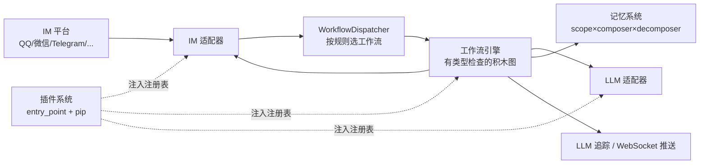

# kirara-ai 拆解与复用裁决

> 产出日期：2026-10-13
> 状态：调研记录（只读源码拆解）。**结论基于实际读到的代码，标注文件路径，未做推测。**
> 产生原因：在「Aimy 直接继承 AIRI v0.12.0-beta.5」的前提下，判断 `kirara-ai` 有哪些能力是 AIRI 缺失或更弱的，是否值得引入及代价。
> 来源：`/Users/mima1234/Documents/资料/拆解项目/kirara-ai-master/`（345 文件 / 288 个 `.py` / 主包 22,106 行 / 67 个测试文件，版本 `3.3.0a2`）。
> 对照对象：本仓 `aimy-app/`（AIRI v0.12.0-beta.5 副本，提交 `bf41903`）。
> 边界：**只读**。未改动任何文件、未安装依赖、未运行服务、未连接任何模型或 IM 平台。
> ⚠️ 许可证：**AGPL-3.0-only**，见 §1.2。本报告是分析产物，不是接入决定。

---

## 1. 项目速览

### 1.1 它是什么

kirara-ai 是一个 **Python 实现的「LLM 虚拟主播 / AI VTuber 服务端框架」**。定位与本项目不同：它不做桌面宠物、不做 3D/Live2D 渲染，而是做一个**中心化的聊天机器人后端**——对接十几个 IM 平台，用可视化工作流编排「收到消息 → 组装提示词 → 调 LLM → 存记忆 → 回消息」的全过程，配一个 Vue 管理台做配置和调试。



| 项目 | 值 | 出处 |
|---|---|---|
| 版本 | `3.3.0a2`（预发布） | `pyproject.toml` |
| 语言 / 运行时 | Python `>=3.10` | `pyproject.toml` |
| 许可证 | **AGPL-3.0-only** | `pyproject.toml` `license` 字段 |
| 主包规模 | 22,106 行 Python | `kirara_ai/**/*.py` |
| 测试 | 67 个测试文件，覆盖 adapter/memory/workflow/web/tracing | `tests/` |
| Web 框架 | **双栈**：FastAPI 主应用 + Quart 挂载在 `/backend-api` | `kirara_ai/web/app.py` |
| 前端 | **不在本仓库**。`web/` 只有 `.gitkeep`；Dockerfile 从 npm 装 `kirara-ai-webui` | `Dockerfile` |
| 打包内插件 | 6 个：4 个 IM 适配器 + LLM 预设适配器 + frpc 内网穿透 | `kirara_ai/plugins/` |
| 工作流积木 | 26 个已注册 block | `workflow/implementations/blocks/system_blocks.py` |
| LLM 适配器 | 14 个（OpenAI/Claude/Gemini/DeepSeek/Ollama/Voyage…） | `plugins/llm_preset_adapters/` |
| TTS / ASR | **不存在**。见下 | — |

### 1.2 ⚠️ 许可证风险专章（AGPL-3.0）

**这一节优先于其他所有结论。**

#### 传染边界：AGPL 比 GPL 多了什么

GPL 的传染由「分发」触发；AGPL 在 GPL 之上加了 **§13 网络交互条款**：如果用户通过网络与修改后的程序交互，你必须向这些用户提供对应的完整源码。也就是说，**开一个服务给外部用，等于一次「分发」**。

具体到 Aimy：

| 场景 | 是否触发 AGPL 义务 | 说明 |
|---|---|---|
| 本地读 kirara-ai 源码学习 | 否 | 未分发、未联网提供服务。用户已确认「现阶段纯自用不外传」 |
| 把它的**设计思路**用 TypeScript 重写进 Aimy | **否** | 著作权保护表达，不保护思想。方案、架构模式、算法思路不受限；照抄代码文本才受限 |
| 复制它的**代码**（哪怕逐行翻译）进 Aimy，且 Aimy 分发给他人 | **是** | 构成衍生作品，Aimy 整体须以 AGPL-3.0 发布 |
| 复制代码进 Aimy 但**永不分发、永不对第三方提供服务** | 义务不激活 | 但这是一条**不能撤销的负债**：未来任何一次分发都要追溯处理 |
| Aimy 未来上架、卖会员、给受邀用户发安装包 | **是** | 一旦落到「分发安装包」或「对外提供服务」，整个产品被迫 AGPL 化 |

**关键判断：Aimy 的路线是「未来要对外分发安装包」（`docs/PROJECT_STATE.md:32` 明确「切换触点是开始对外分发安装包」）。因此对本项目而言，AGPL 传染不是理论风险，而是一条被推迟的必然事件。**

#### 逐行翻译算不算抄袭 —— 算

Python → TypeScript 的逐行翻译在法律上是**衍生作品**，不是独立创作。变量改名、语法改写、加注释，都不改变这一点。**唯一安全的路径是只取设计与思路，用 TypeScript 从其自身的架构需求出发重新实现。**

#### 本项目应遵守的距离

1. **不复制任何 `.py` 文件、代码片段、注释文本、提示词模板到 `aimy-app/`。**
2. **不引入 kirara-ai 的任何 Python 依赖**到 Aimy 的依赖图（本项目是 TS/Electron，本来也不该引）。
3. 借鉴设计时，**在 Aimy 侧的代码注释或设计文档中记录思想来源**（「参考 kirara-ai 的 registry 模式」），这与复制代码不同，反而是合规的好习惯。
4. **数据格式也要小心**：kirara-ai 的工作流 YAML、调度规则 YAML 是它的文件格式，直接沿用其 schema 并分发有争议；若确实需要相似格式，应重新设计字段。
5. 若未来确需引入其代码（本报告没有任何一项裁决为「直接复用代码」，见 §6），必须**同时**决定 Aimy 是否接受 AGPL——这是一次全产品级的决定，不是单模块的取舍。

> **一句话：kirara-ai 对本项目的价值是「一座可以参观的建筑」，不是「一车可以拉走的砖」。**

### 1.3 两个必须先说的负面发现

拆解中确认两件事与任务书预设不符，必须如实记录，避免下游误用：

| # | 任务书预设 | 实际读到的 | 影响 |
|---|---|---|---|
| 1 | 需考察 `tts/`、`asr/` 子系统 | **v3.3.0a2 中不存在 `tts/` 与 `asr/` 目录**。全树 grep 只命中 `im/message.py` 的 `VoiceMessage` 元素、`llm/model_types.py` 的模型类型字符串、以及 mock 测试。README 声称 v2.2.5 起支持 Azure/VITS TTS，但该实现在本副本中缺失 | **TTS/ASR 不在本次评估范围**，不予编造。Aimy 的语音能力本来也来自 AIRI（`packages/audio`、`provider-inference` 的 7 个本地语音 provider） |
| 2 | 需考察 Vue Web 管理台页面 | **Vue 前端不在本仓库**。`web/` 只有 `.gitkeep`；`Dockerfile` 从 npm 包 `kirara-ai-webui` 安装；README 指向独立仓库 `DarkSkyTeam/kirara-webui` | Web 管理台只能从**后端 API 面**（11 个 blueprint）、**插件静态资源注入**、**block 自省与 LSP endpoint** 三个角度评估，见 §2.19、§3.5 |

---

## 2. 完整功能清单表

成熟度判定标准：**成熟** = 有实现 + 有测试 + 在启动路径真实接线；**可用** = 有实现，测试或接线有缺口；**实验** = 实现存在但边界明显残缺；**缺失** = 只有接口或声明。

| 编号 | 功能 | 做什么 | 实现方式 | 核心文件 | 成熟度 |
|---|---|---|---|---|---|
| F1 | 插件发现与加载 | 同时支持内置插件目录扫描和第三方 pip 包 | 内置：扫目录 + `importlib.import_module`；外部：`importlib.metadata.distributions()` 过滤 entry_point 组 | `plugin_manager/plugin_loader.py` | 成熟 |
| F2 | 插件安装/卸载/更新 | 从插件市场一键装包 | `asyncio.create_subprocess_exec` 调用 pip，流式回报 stdout/stderr 到 WebSocket | `plugin_manager/plugin_loader.py` | 可用 |
| F3 | 插件热启停 | 不重启进程启停插件 | `enable_plugin`/`disable_plugin` 实时 load/stop 并改写 `config.plugins.enable`；`requires_restart` 标记需重启的场景 | `plugin_manager/models.py` | 可用 |
| F4 | 插件事件隔离 | 停用插件时摘掉它注册的全部监听器 | `PluginEventBus` 包装真 `EventBus`，记录每个 listener，`unregister_all()` 统一摘除 | `plugin_manager/plugin_event_bus.py` | 成熟 |
| F5 | 插件市场 | 搜索/详情/安装/升级 | 后端代理 `kirara-plugin.app.lss233.com/api/v1`，合并市场元数据与本地安装态算出 `isInstalled`/`isUpgradable` | `web/api/plugin/routes.py` | 成熟 |
| F6 | 依赖注入容器 | 全局 + 作用域两级解析 | `DependencyContainer` 父链查找；`ScopedContainer` 用 `contextvars` 保证协程/线程安全 | `ioc/container.py`、`ioc/inject.py` | 成熟 |
| F7 | 注解式注入 | 按类型注解自动注入构造参数/属性 | `Inject` 装饰器与类，反射注解后从容器解析 | `ioc/inject.py` | 成熟 |
| F8 | IM 适配器抽象 | 一套接口接十几个平台 | `IMAdapter` ABC 四方法（`convert_to_message`/`send_message`/`start`/`stop`） | `im/adapter.py` | 成熟 |
| F9 | 适配器能力协议 | 适配器**可选**声明额外能力 | `@runtime_checkable` Protocol：`EditStateAdapter`/`UserProfileAdapter`/`BotProfileAdapter`，用 `isinstance` 判定 | `im/adapter.py` | 成熟 |
| F10 | IM 注册表 | 平台名 → (适配器类, 配置类, 多语言名) | `IMRegistry`，附 `localized_name`/`detail_info_markdown` 供 WebUI 渲染 | `im/im_registry.py` | 成熟 |
| F11 | 适配器生命周期管理 | 按配置启停适配器 | `IMManager.start_adapters` 从注册表解析类，在 scoped container 注册配置类后实例化 | `im/manager.py` | 可用（有异步反模式） |
| F12 | 统一消息模型 | 跨平台统一的消息元素树 | `MessageElement` 抽象 → `Text`/`Image`/`Voice`/`Video`/`File`/`Mention`/`Reply`/`Face`/`Json` | `im/message.py` | 成熟 |
| F13 | 用户资料归一化 | 跨平台统一的用户画像结构 | `UserProfile` pydantic 模型（昵称/性别/年龄/头像/等级/语言/`extra_info`） | `im/profile.py` | 成熟 |
| F14 | 工作流引擎 | 有类型检查的积木连线图 | `Block`+`Input`/`Output`+`Wire`，构图时校验类型兼容，不兼容抛 `TypeError` | `workflow/core/execution/executor.py` | 成熟 |
| F15 | 条件与循环积木 | 分支、循环控制流 | `ConditionBlock`/`LoopBlock`/`LoopEndBlock`，分支按索引选 then/else | `workflow/core/block/base.py` | 可用 |
| F16 | 积木注册表 | 积木类型自省并暴露给可视化编辑器 | `BlockRegistry` 用 `f"{group_id}:{block_id}"`；`extract_block_info` 反射 `__init__` 生成配置表单 | `workflow/core/block/registry.py` | 成熟 |
| F17 | 类型系统 | 积木间连线的类型兼容判定 | `TypeSystem`，注册积木时自动登记其输入输出类型 | `workflow/core/block/registry.py` | 成熟 |
| F18 | 内联代码积木 | 用户在工作流里写 Python 并执行 | `CodeBlock.execute()` 直接 `exec(self.code, ...)` **进程内执行用户代码** | `workflow/implementations/blocks/system/basic.py` | ⚠️ 成熟但危险 |
| F19 | 消息调度规则 | 按优先级+条件决定哪条消息走哪个工作流 | `CombinedDispatchRule`：组间 AND、组内 AND/OR；`WorkflowDispatcher` 按优先级遍历，首个命中即执行 | `workflow/core/dispatch/dispatcher.py`、`dispatch/models/dispatch_rules.py` | 成熟 |
| F20 | 规则类型 | 前缀/被@/聊天类型/正则/关键词/兜底 | 各 `Rule` 子类 + YAML 持久化 | `data/dispatch_rules/rules.yaml` | 成熟 |
| F21 | LLM 适配器抽象 | 统一多厂商 LLM 接入 | `LLMBackendAdapter` ABC + `LLMBackendRegistry`（大小写不敏感查找） | `llm/adapter.py`、`llm/llm_registry.py` | 成熟 |
| F22 | LLM 能力协议 | 可选声明嵌入/重排/自动探测模型 | `LLMChatProtocol`/`LLMEmbeddingProtocol`/`LLMReRankProtocol`/`AutoDetectModelsProtocol` | `llm/adapter.py` | 成熟 |
| F23 | 提示词变量替换 | 模板里插时间/用户名/消息/记忆/任意变量 | `ChatMessageConstructor` 支持 `{current_date_time}`、`{user_msg}`、`{memory_content}` 与通用 `{var.path}` | `workflow/implementations/blocks/llm/chat.py` | 成熟 |
| F24 | 多段回复切分 | 一次生成拆成多条消息发送 | `ChatResponseConverter` 按 `<break>` 标记切分为多个 `TextMessage` | `workflow/implementations/blocks/llm/chat.py` | 成熟 |
| F25 | 工具调用循环 | 让模型多轮调用工具直至收敛 | `ChatCompletionWithTools`，`max_iterations=4`，末轮强制 `tool_choice="none"` | `workflow/implementations/blocks/llm/chat.py` | 成熟 |
| F26 | 记忆作用域 | 成员/群/全局三级记忆隔离 | `MemberScope`（`member:{gid}:{uid}`）、`GroupScope`、`GlobalScope` | `memory/scopes/builtin_scopes.py` | 成熟 |
| F27 | 记忆组装/拆解 | 消息与记忆条目间的双向转换 | `Composer`/`Decomposer` 因子化，默认实现收集 `_media_ids`/`_tool_calls` 到元数据 | `memory/composes/builtin_composes.py` | 成熟 |
| F28 | 记忆持久化 | 文件或 Redis 两种后端 | `FileMemoryPersistence`（每 scope 一个 JSON）/`RedisMemoryPersistence`，包在 `AsyncMemoryPersistence` 外 | `memory/persistences/` | 成熟 |
| F29 | 记忆查询 | 按作用域取历史条目 | `MemoryManager.query()` **线性扫描全部 scope key** 再用 `scope.is_in_scope` 过滤 | `memory/memory_manager.py` | ⚠️ 可用（性能缺陷） |
| F30 | 媒体资源管理 | 媒体文件登记、引用计数、清理 | `MediaManager` 每个 media_id 一份元数据 JSON，引用计数归零即回收 | `media/manager.py` | 成熟 |
| F31 | LLM 请求追踪 | 记录每次 LLM 调用并可实时查看 | SQLAlchemy + WebSocket 广播，内容可脱敏（`UNRECORD_REQUEST`/`UNRECORD_RESPONSE`），30 天保留 | `tracing/llm_tracer.py` | 成熟 |
| F32 | 追踪统计 | 用量概览/按天/按时/按模型/按后端 | `get_statistics()` 多维度聚合 | `tracing/llm_tracer.py` | 成熟 |
| F33 | 事件总线 | 同步的类型→监听器广播 | `EventBus`，单监听器异常隔离不影响其他 | `events/event_bus.py` | 成熟 |
| F34 | Web 服务 | 主 API + 插件 API 双栈 | FastAPI 主应用 + Quart 挂 `/backend-api`，11 个 blueprint | `web/app.py` | 成熟 |
| F35 | 插件静态资源注入 | 插件往 Web 服务器挂自己的图标等资源 | `self.web_server.add_static_assets("/assets/icons/im/qqbot.png", local_path)` | `plugins/im_qqbot_adapter/__init__.py` | 成熟 |
| F36 | 认证 | 首次设密码 + JWT | `FileBasedAuthService`：密码哈希落文件，签发/校验 JWT | `web/auth/services.py` | 成熟 |
| F37 | 浏览器内 Python IDE | 在管理台里写代码，带补全与检查 | WebSocket LSP endpoint 内嵌 pygls + jedi + pyflakes | `web/api/block/routes.py` | ⚠️ 成熟但危险 |
| F38 | MCP 集成 | 接 MCP 服务器并把工具暴露成积木 | `MCPServerManager` 管 stdio/sse 连接，工具/提示词/资源三类缓存 | `mcp_module/manager.py` | 成熟 |
| F39 | 配置即模型 + 自动迁移 | 配置用 pydantic 定义并支持旧格式升级 | `LLMBackendConfig.migrate_models_format` 自动把旧配置转新格式 | `config/global_config.py` | 成熟 |
| F40 | 内网穿透 | 内置 frpc，让本机服务被外部 IM 回调 | 打包插件 `bundled_frpc` + `FrpcConfig` | `config/global_config.py` | 可用 |
| F41 | TTS / ASR | — | **本副本不存在该子系统** | — | 缺失 |
| F42 | 向量/语义记忆检索 | — | **不存在**。记忆是有上限的消息日志（`max_entries=100`），`query()` 为线性扫描，无嵌入检索 | `memory/memory_manager.py` | 缺失 |

### 2.1 一张图看清消息全流程

一次 IM 消息从进入到回复，经过的节点（全部有代码依据）：

```
平台消息
  └─ 适配器 convert_to_message()          → IMMessage(sender + message_elements)   im/message.py
       └─ dispatcher.dispatch(adapter, msg)                                         dispatch/dispatcher.py
            ├─ 开 scoped container，注册 IMAdapter / IMMessage
            ├─ 按优先级遍历 active rules，CombinedDispatchRule.match() 首个命中
            └─ 用命中的 workflow 建 WorkflowExecutor
                 ├─ _build_execution_graph：校验 wire 类型兼容（不兼容 → TypeError）
                 ├─ run()：发 WorkflowExecutionBegin，套 asyncio.timeout
                 └─ 逐个 block.execute()
                      ├─ ChatMemoryQueryBlock   → 取历史
                      ├─ ChatMessageConstructor → 变量替换组装提示词
                      ├─ ChatCompletion          → 或 ChatCompletionWithTools（最多 4 轮）
                      ├─ ChatMemoryStore        → 写回记忆
                      ├─ ChatResponseConverter  → 按 <break> 切段
                      └─ IMSendBlock            → adapter.send_message()
```

**关键观察：这条链路是「可编排的」——提示词、记忆读写、回复切分都是积木，能被用户在管理台里拖拽重排。** 这是 kirara-ai 相对本项目的最大范式差异。

---

## 3. 插件架构专章

### 3.1 kirara-ai 的插件设计原则

它的插件系统建立在四个机制上，缺一不可：

| 原则 | 具体做法 | 代码 |
|---|---|---|
| **注册表而非继承** | 核心不 `import` 任何具体适配器；插件把「名字 → (类, 配置类, 多语言元数据)」注册进 registry，核心只认 registry | `im/im_registry.py`、`llm/llm_registry.py`、`workflow/core/block/registry.py` |
| **入口点发现** | 第三方插件是普通 pip 包，通过 `entry_points` 组 `chatgpt_mirai.plugins` 声明；核心遍历 `importlib.metadata.distributions()` 找它 | `plugin_manager/plugin_loader.py` |
| **生命周期钩子** | 插件契约只有三个方法：`on_load`（注册能力）/`on_start`（启连接）/`on_stop`（清理） | `plugin_manager/plugin.py` |
| **作用域容器 + 插件事件总线** | 每个插件在 scoped container 中实例化，容器内注入 `PluginEventBus`；停用时 `unregister_all()` 摘掉该插件注册的所有监听器 | `plugin_manager/plugin_loader.py:instantiate_plugin` |

插件契约本体极简：

```python
class Plugin(ABC):
    ENTRY_POINT_GROUP = "chatgpt_mirai.plugins"
    event_bus: EventBus
    workflow_dispatcher: WorkflowDispatcher
    llm_registry: LLMBackendRegistry
    im_registry: IMRegistry
    im_manager: IMManager

    @abstractmethod
    def on_load(self): pass
    @abstractmethod
    def on_start(self): pass
    @abstractmethod
    def on_stop(self): pass
```

**插件能在不改核心一行代码的前提下做到什么**（均有实例）：

1. **加一个 IM 平台** —— `im_qqbot_adapter/__init__.py:20` 注册 `qqbot` 适配器。
2. **加一批 LLM 厂商** —— `llm_preset_adapters/__init__.py` 一次注册 14 个适配器。
3. **加工作流积木** —— 可注册新 `Block` 到 `BlockRegistry`，出现在可视化编辑器里。
4. **往 Web 服务器注入静态资源** —— `self.web_server.add_static_assets("/assets/icons/im/qqbot.png", local_logo_path)`。**这一条很关键：插件能给管理台加 UI 资产，不需要碰前端仓库。**

### 3.2 它的依赖与隔离真相

要对「插件隔离」这件事诚实：

| 问题 | 实际答案 | 依据 |
|---|---|---|
| 有沙箱吗？ | **没有**。插件与核心同进程，拿到的是**同一个** `im_registry`/`llm_registry` 对象引用 | `instantiate_plugin` 只包了一层 `PluginEventBus` |
| 有权限声明吗？ | **没有**。插件 import 得到什么就能用什么 | `plugin.py` 契约无权限字段 |
| 有模块级隔离吗？ | **没有**。第三方插件是 pip 包装进同一解释器 | `plugin_loader.py` |
| 依赖怎么管？ | **完全交给 pip**。install/update/uninstall 都是 `pip` 子进程 | `plugin_loader.py` |
| 版本冲突怎么办？ | **不解决**。无版本解析、无多版本共存 | 同上 |
| 装坏了怎么办？ | **可能整进程起不来**，部分路径靠 `requires_restart` 兜底 | `plugin_manager/models.py` |
| 唯一的「隔离」是什么？ | **事件监听器清理**：停用插件时摘掉它的 listener，避免残留回调 | `plugin_event_bus.py` |

所以「kirara-ai 插件系统最强」这个判断需要修正为：**它强在「注册表式扩展性 + UI 资产注入」，不强在「隔离与安全」。**

### 3.3 AIRI 的对应体系（已核实）

AIRI 侧不是「没有插件系统」，而是**分成了三层，且安全模型比 kirara-ai 完整得多**：

| 层 | 位置 | 作用 | 关键证据 |
|---|---|---|---|
| plugin-sdk | `packages/plugin-sdk/src/` | 插件宿主、协议、运行时 | `plugin-host/runtimes/{node,web,shared}` 三套 runtime |
| plugin-protocol | `packages/plugin-protocol/` | 清单与权限的协议类型 | `manifest.ts` 用 valibot 严格校验 `ExtensionManifestV2`，返回**逐字段诊断路径** |
| channel / server | `packages/server-sdk`、`server-runtime`、`server-shared` | 跨进程/跨机通信 | `server-runtime/src/server-ws/airi/` 有 `codec`/`routing`/`liveness`/`consumers` |

**逐项对比：**

| 维度 | kirara-ai | AIRI | 谁更好 |
|---|---|---|---|
| 插件发现 | pip entry_points 组 `chatgpt_mirai.plugins` | Extension manifest v2 + 目录导入 + 宿主列举 | AIRI（清单可校验、有诊断） |
| 清单校验 | 无独立清单，靠 pip 元数据 | `parseExtensionManifest` 严格 schema 校验，失败返回字段级 `path`+`message` | **AIRI** |
| 权限模型 | **无** | 有 `ModulePermissionDeclaration`/`Grant`，动作级匹配 + 通配符（`matchKey` 支持 `*` 前缀） | **AIRI** |
| 运行时 | 单进程 Python | node / web / shared 三套，按运行时过滤能力 | **AIRI** |
| 能力声明 | registry 注册（全局可见） | `KitDescriptor`：kitId+version+runtimes+capabilities，**注册冲突直接抛错** | AIRI（有冲突检测） |
| 依赖就绪 | pip 装完就算好 | `DependencyService`：`announce`→`markReady`→`degrade`/`withdraw` 状态机，**插件可等待其他能力就绪再启动** | **AIRI** |
| 安装方式 | 运行时装 pip 包 | 目录导入（带 plan 审批 + owner 校验） | **AIRI**（无运行时代码注入） |
| 前端资产注入 | 插件可挂静态资源到 Web 服务器 | 插件提供 widget / tool / gamelet kit | AIRI（结构化而非裸文件） |
| 生态成熟度 | **有公开市场 + 一键安装**，用户可自助 | 机制完整，市场未成型 | **kirara-ai** |
| 心智负担 | 三个钩子方法，极易上手 | manifest + permissions + kits + runtimes，概念多 | **kirara-ai** |

**AIRI 侧一处必须点明的现状**：`packages/plugin-sdk/src/plugin-host/runtimes/` 下**没有发现 `isolated-vm` 或独立沙箱**的引用（针对 `isolated-vm|sandbox` 的定向 grep 无命中）。所以 AIRI 的安全优势来自**权限声明 + 清单校验 + 目录导入审批**，而不是「内存级沙箱执行」。这一点在向用户汇报时不能说成「AIRI 有沙箱」。

### 3.4 两种设计的本质差异（一句话）

> **kirara-ai 的插件是「往一张全局能力表里加一行」，AIRI 的插件是「带清单和权限来申请一组能力」。前者扩展快、无安全边界；后者扩展慢、有安全边界。**

考虑到 Aimy 是**单用户桌面产品**，kirara-ai 的「快」在这个场景里收益有限，而它缺失的权限边界恰恰是 `docs/02-调研参考/2026-10-12-Open-LLM-VTuber深度复用评估.md` 一类文档反复强调的保护项。

### 3.5 kirara-ai 插件方案的三个可借鉴点（不含代码）

1. **「能力表」思想**：核心永不 import 具体实现，只认 registry。Aimy 若要做「可替换的 LLM/TTS/工具提供方」，registry 模式比 switch-case 好。**注意：AIRI 的 `provider-inference` 已经是注册表式了**（`providers/cloud/` 42 个 + `providers/local/` 7 个），所以这条 Aimy 其实已有。
2. **插件自带 UI 资产**：让扩展点自己声明界面资源和元数据（多语言名、描述、图标），核心用自省生成配置表单。AIRI 的 kit/widget 体系是同一思路的更结构化版本，可直接参考。
3. **生命周期钩子极简**：三个方法就能完整表达一个扩展点。这对 Aimy 未来做「用户自定义模块」有参考价值——**契约越薄，越容易被第三方实现**。

---

## 4. 架构总结

### 4.1 分层

```
┌─ 入口 ────────── entry.py：容器 → 配置 → 注册表 → 管理器 → 记忆 → 媒体 → 追踪
│                            → 积木 → 插件发现/加载 → 工作流 → 调度规则 → LLM → MCP
├─ Web 层 ──────── FastAPI 主应用 + Quart /backend-api + 11 blueprints + JWT
├─ 调度层 ──────── WorkflowDispatcher：规则匹配 → 选工作流 → 建执行器
├─ 工作流层 ────── Block / Wire / TypeSystem / WorkflowExecutor / 26 个积木
├─ 领域层 ──────── IM 适配器 · LLM 适配器 · 记忆 · 媒体 · MCP
├─ 基础设施层 ──── DependencyContainer / ScopedContainer / Inject · EventBus
└─ 持久化 ──────── 文件 / Redis（记忆）· SQLAlchemy（追踪）· YAML（工作流与规则）
```

### 4.2 值得学习的设计决定

| # | 设计 | 为什么好 | Aimy 是否需要 |
|---|---|---|---|
| D1 | **连线时类型校验** | 工作流在**构图阶段**就发现类型不兼容并抛 `TypeError`，而不是运行时炸 | 若 Aimy 做可视化编排则需要；当前不需要 |
| D2 | **作用域容器 + contextvars** | 同一份代码在「适配器 A 的上下文」和「适配器 B 的上下文」里解析出不同实例，且协程安全 | 模式可借鉴；AIRI 用 Eventa + Pinia 解决同类问题 |
| D3 | **runtime_checkable Protocol 做可选能力** | 适配器只在**支持时**实现某个 Protocol，调用方 `isinstance` 判定后降级 | **值得借鉴**。比「基类塞一堆空方法」干净 |
| D4 | **配置自动迁移** | `migrate_models_format` 让老配置无痛升级，用户不用手改 YAML | **值得借鉴**。Aimy 做设置有版本迭代需求 |
| D5 | **积木自省生成 UI** | `extract_block_info` 反射 `__init__` 自动产出配置表单，加积木不用改前端 | **值得借鉴**的思路：设置项从 schema 生成 |
| D6 | **插件自带多语言元数据** | registry 存 `localized_name`/`localized_description`，扩展点自动进 i18n | 与 AIRI 的 i18n 体系一致，Aimy 已有 |
| D7 | **媒体引用计数** | 媒体文件按引用数回收，记忆删条目时不留垃圾 | 若 Aimy 长期存截图/语音则有价值 |
| D8 | **追踪内容可脱敏** | 记录 LLM 调用但允许不记内容 | **值得借鉴**，隐私与可调试性的平衡 |

### 4.3 技术债（诚实清单）

| # | 债务 | 证据 | 严重度 |
|---|---|---|---|
| T1 | **`CodeBlock` 进程内 `exec()` 用户代码** | `workflow/implementations/blocks/system/basic.py`：`exec(self.code, exec_globals, exec_locals)` | 高 |
| T2 | **浏览器内 Python LSP** | `web/api/block/routes.py` 的 `/code/lsp` 内嵌 pygls+jedi+pyflakes | 高 |
| T3 | **CORS `allow_origins=["*"]`** | `web/app.py` | 中 |
| T4 | **记忆查询线性扫描** | `memory_manager.py:query()` 扫全部 scope key | 中 |
| T5 | **异步反模式** | `im/manager.py` 在运行中的 loop 里 `loop.run_until_complete`；`im/user_profile.py` block 里 `asyncio.run()`；`im/message.py` 为注册媒体**起线程再 join** | 中 |
| T6 | **5 个插件的 entry_point 全部指向不存在的模块与类** | 6 个打包插件的 `setup.py` 都声明 `xxx.plugin:<X>Plugin`，但树中**不存在任何 `plugin.py`**，类实际定义在各 `__init__.py` 里，且名字对不上（详见 §4.4） | 中 |
| T7 | **配置普遍 `extra="allow"`** | `config/global_config.py` 多处 | 低（灵活但无校验） |
| T8 | **`IMMessage.content` 拼接逻辑** | 文本元素后补 `\n`，非文本元素直接串接，可读性受影响 | 低 |
| T9 | **运行时 pip 安装** | `plugin_loader.py` 直接调 pip，无版本解析、无回滚 | 中 |
| T10 | **单进程承载所有适配器** | 一个适配器抛未捕获异常可能影响全局 | 中 |

### 4.4 T6 的完整证据：6 个打包插件的 entry_point 全是死代码

这是拆解中发现的**最具体的工程缺陷**，因为它同时暴露了「核心与插件的接缝没被测过」。

每个打包插件都有两份重复的注册声明：`setup.py` 里的 `entry_points`（面向 pip 安装的第三方路径）和各插件 `__init__.py` 里的类（面向内置目录发现的路径）。逐项核对结果：

| 插件 | `setup.py` 声明的入口 | 树中是否存在 | `__init__.py` 实际类名 | 对得上吗 |
|---|---|---|---|---|
| `im_qqbot_adapter` | `im_qqbot_adapter.plugin:QQBotAdapterPlugin` | ❌ 无 `plugin.py` | `QQBotAdapterPlugin`（`__init__.py:13`） | 模块错，类名对 |
| `im_telegram_adapter` | `im_telegram_adapter.plugin:TelegramAdapterPlugin` | ❌ 无 `plugin.py` | `TelegramAdapterPlugin`（`__init__.py:13`） | 模块错，类名对 |
| `im_wecom_adapter` | `im_wecom_adapter.plugin:WeComAdapterPlugin` | ❌ 无 `plugin.py` | `WecomAdapterPlugin`（`__init__.py:13`） | **模块错 + 大小写错**（`WeCom` vs `Wecom`） |
| `im_http_legacy_adapter` | `im_http_legacy_adapter.plugin:HttpLegacyAdapterPlugin` | ❌ 无 `plugin.py` | `HttpLegacyAdapterPlugin`（`__init__.py:12`） | 模块错，类名对 |
| `llm_preset_adapters` | `llm_preset_adapters.plugin:LLMPresetsPlugin` | ❌ 无 `plugin.py` | `LLMPresetAdaptersPlugin`（`__init__.py:22`） | **模块错 + 类名错** |
| `bundled_frpc` | 无 `setup.py` | — | — | — |

树中仅有的两个 `plugin.py` 是 `kirara_ai/plugin_manager/plugin.py`（插件契约）与 `kirara_ai/events/plugin.py`（事件），都不是插件实现。

**为什么这不影响运行**：`pyproject.toml` 用 `include = ["kirara_ai*"]` 把整个 `kirara_ai` 打成一个包，插件是**内置子包**，走 `discover_internal_plugins()` 扫目录 + `importlib.import_module` 加载，全程不读 `entry_points`。这些 `setup.py` 是历史遗留的独立打包配置，实际未被使用。

**为什么仍然值得记为技术债**：`entry_points` 是第三方插件（`discover_external_plugins()` 遍历 `importlib.metadata.distributions()` 找 `chatgpt_mirai.plugins` 组）的**唯一发现通道**。core 自带的示例插件把这条通道写错了，意味着**外部开发者照抄这套 setup.py 会直接失败**，而错误发生在 pip 元数据层，运行时只表现为「插件静默未加载」，极难排查。这也侧面说明该路径缺少端到端测试。

---

## 5. 对照 AIRI 的差距分析表

> AIRI 现状一列均来自对 `aimy-app/` 的实际读取。

| 能力 | AIRI 现状 | kirara-ai 做法 | Aimy 是否缺 | 差距有多大 |
|---|---|---|---|---|
| LLM 多厂商接入 | **很强**。`packages/provider-inference/src/providers/cloud/` 有 **42 个**厂商目录（anthropic/openai/google/deepseek/xai/groq/mistral…），`local/` 7 个（ollama/lm-studio/voicevox…） | 14 个适配器 + registry | **不缺** | 无差距，**AIRI 更厚** |
| IM 平台接入 | **弱**。只有 `stores/modules/discord.ts`、`twitter.ts` 等配置型模块（仅存 token/enabled，通过 configurator 广播），无统一适配器抽象 | 统一 `IMAdapter` 抽象 + 4 个已实现平台（QQ/微信/Telegram/HTTP legacy）+ 注册表 + 能力协议 | **缺** | **差距大**，这是 kirara-ai 最突出的相对优势 |
| 插件/扩展体系 | **有且更安全**。plugin-sdk 三套 runtime、manifest v2 严格校验、权限声明与授予、Kit 冲突检测、`DependencyService` 就绪状态机、目录导入带审批 | entry_point 发现 + registry 注册 + pip 安装 | **不缺** | AIRI **安全性更强**，kirara-ai 只赢在「有市场」 |
| 插件市场与自助安装 | 无成型市场 | 有公开市场，一键装/升/停，Web 界面 | 缺 | 中（但**对本项目价值低**，见 §6） |
| 工作流可视化编排 | **无此概念**。Aimy 的流程是代码写死的（`core-agent` 的 agents/session/runtime + `stores/character/orchestrator`） | 26 积木 + 类型校验 + 可视化编辑器 + 条件/循环 | **缺** | **差距大**，但是**架构范式差异**，不是补丁级差距 |
| 消息调度规则 | 无。无「按前缀/@/正则/关键词选流程」机制 | 6 种规则 + 优先级 + 组间 AND/组内 AND-OR + YAML 持久化 | 缺 | 中（桌面单用户场景需求弱） |
| 记忆：作用域分层 | 无 | 成员/群/全局三级 | 缺 | 中（单人桌面场景只需全局+会话级） |
| 记忆：持久化 | **无实现**（`packages/memory-pgvector/src/` 只有一个空 `index.ts` 外壳；三个记忆设置页均为 `<WIP />`） | 文件/Redis 双后端 + `AsyncMemoryPersistence` | **缺** | **差距大，且这是 Aimy 已立项的自建范围（R4）** |
| 记忆：语义检索 | 无实现 | **也没有**。`query()` 线性扫描，`max_entries=100`，无嵌入/向量检索 | **双方都缺** | **kirara-ai 在此无参考价值** |
| 人设 / 角色卡 | **有**。`stores/modules/airi-card.ts` 接 `@proj-airi/ccc` 的 Card/ccv3 格式，带 `document-sync` 同步与继承；`packages/core-character` | 提示词模板写在 workflow YAML 的 `text_block` 里，用 `{user_name}`/`{memory_content}` 变量 | **不缺** | AIRI 更强（标准化角色卡 vs 文本模板） |
| TTS / ASR | **有**。`packages/audio`、`services/speech/`、`stores/modules/speech.ts`、`architecture: hearing.ts`，provider 侧有 7 个本地语音 provider（voicevox / player2-speech / index-tts-vllm / browser-web-speech-api / sherpaw-transcription…） | **本副本无该子系统** | **不缺** | **AIRI 完胜，kirara-ai 无可借鉴** |
| 消息统一模型 | 无跨平台消息元素树 | `MessageElement` 9 种元素 + `IMMessage` + `content`/`images`/`voices` 便捷访问器 | 缺 | 中（只在做 IM 接入时才有意义） |
| MCP 集成 | **有**（`stores/mcp.ts`、`apps/.../main/services/airi/mcp-servers/`、`stores/mcp-tool-bridge.ts`） | `MCPServerManager` + 工具/提示词/资源缓存 | **不缺** | AIRI 已覆盖 |
| 用户画像归一化 | 无统一结构 | `UserProfile` + `Gender` + `extra_info` | 缺 | 小-中 |
| LLM 调用追踪 | 有 `io-trace-recording` 服务 | SQLAlchemy + WebSocket 实时 + 多维度统计 + 内容脱敏 | 部分 | 小-中，kirara-ai 的统计面板思路可参考 |
| 设置界面生成方式 | 手写 Vue 页面 + `settingsEntry: true` 路由标记（8 个入口：airi-card/connection/data/models/memory/modules/providers/scene） | 从 block/registry 自省生成表单 + 插件注入资产 | 不缺 | AIRI 已有完整设置框架 |
| 跨设备/跨进程通信 | **有**。Eventa IPC + `server-runtime`（WS、路由、存活检测、codec）+ `server-sdk` + channel-server（含 mkcert 自签 TLS） | dispatcher + scoped container | 不缺 | 两者思路接近，AIRI 的传输层更工程化 |
| 视觉/看屏 | **有**。`stores/modules/vision/`（processing-store/orchestrator/activity）+ `electron-screen-capture` | 无 | 不缺 | AIRI 独有 |
| 自主循环/意识流 | **有**。`stores/modules/consciousness.ts`、`artistry-autonomous.ts` | 无 | 不缺 | AIRI 独有 |

**差距分析一句话**：**kirara-ai 相对 AIRI 的优势集中在「IM 多平台接入」和「工作流可视化编排」两块，以及「插件市场」这一生态位；它在 TTS/ASR、人设/角色卡、记忆语义检索、多厂商 LLM 覆盖上都不如 AIRI 或同样缺失。**

---

## 6. 复用裁决表

**裁决口径**：因 AGPL-3.0，**「直接复用代码」不出现**。所有可取项一律为「借鉴设计 + 用 TypeScript 重新实现」。跨语言（Python→TypeScript）本身也要求重写。

| 能力 | 裁决 | 理由 | 落地方式 | 成本 | 优先级 |
|---|---|---|---|---|---|
| **runtime_checkable Protocol 式可选能力声明** | **借鉴设计** | 适配器只在支持时实现某能力，调用方判定后降级。比基类空方法干净；AIRI 的 manifest/kit 体系里也有同构思想，可统一 | 在 Aimy 侧用 TS `interface` + 运行时标记（或 type guard）重写 | 小 | **P1** |
| **配置项 schema 化 + 自动迁移** | **借鉴设计** | `migrate_models_format` 让老配置无痛升级。Aimy 设置项会持续演进，缺这层就会逼用户删配置重来 | 为 Aimy 的设置持久化加版本号 + migrate 函数 | 小-中 | **P1** |
| **设置项由 schema 自省生成 UI** | **借鉴设计** | `extract_block_info` 反射 `__init__` 生成表单，加一项不用改前端。AIRI 设置页是手写的，长期维护成本随项数增长 | 定义设置项 descriptor，渲染层统一出表单 | 中 | **P2** |
| **记忆的作用域因子化（scope × composer × decomposer）** | **借鉴设计** | 三层正交拆分干净：作用域决定「谁的记忆」，composer/decomposer 决定「怎么进出」。**直接服务 Aimy 已立项的 R4 记忆自建** | 在 Aimy 记忆模块中用 TS 重新设计等价抽象，作用域按桌面场景收敛为「会话级 + 全局」 | 中 | **P1** |
| **追踪内容可脱敏** | **借鉴设计** | 记录调用但允许不记内容，兼顾可调试与隐私 | 在 Aimy 的 LLM 调用日志层加开关 | 小 | **P2** |
| **媒体引用计数回收** | **借鉴设计** | 记忆删条目时不留孤儿文件。Aimy 若要长期存看屏截图/语音会需要 | 自建轻量引用计数 | 小-中 | **P3** |
| **插件自带 UI 资产/元数据的注册表模式** | **借鉴设计** | 扩展点自声明多语言名、描述、图标与界面资源，核心自省渲染。AIRI 已有更结构化的 kit/widget 版本，**优先沿 AIRI 已有路线走** | 主要参考 AIRI 自身机制；kirara-ai 只作旁证 | 小 | **P3** |
| **IM 适配器四方法抽象 + 注册表** | **借鉴设计（暂不落地）** | 设计干净，但 Aimy 当前**没有 IM 接入需求**（桌面产品，非聊天机器人后端）。先记录形态，需求出现时再实现 | 记录接口形态；需求出现后用 TS 重写 | 中（若启动） | **P3** |
| **按规则的消息调度** | **借鉴设计（暂不落地）** | 依赖 IM 多平台前提；桌面单用户场景价值低 | 随 IM 需求一起评估 | 中 | **P3** |
| **工作流可视化编排（积木图 + 类型校验）** | **借鉴设计（有条件）** | 架构范式差异大，与 Aimy「角色驱动 + 代码流程」的现状冲突。**除非出现「用户想自定义她的行为流程」的真实需求，否则不应引入** | 若引入：重做类型系统与执行器；不沿用其 YAML schema | 大 | **P4** |
| `CodeBlock` 进程内 `exec()` | **弃用** | 执行用户代码无沙箱，是明确安全缺陷 | — | — | — |
| 浏览器内 Python LSP endpoint | **弃用** | 与 Aimy 无关且是攻击面 | — | — | — |
| `IMManager` 的 `loop.run_until_complete` / block 内 `asyncio.run()` | **弃用** | 异步反模式，会阻塞或重复建 loop | — | — | — |
| 记忆 `query()` 线性扫描实现 | **弃用** | 性能缺陷；即便借鉴作用域抽象也不能照搬查询实现 | — | — | — |
| pip 子进程装插件 | **弃用** | 无版本解析、无回滚、运行时改依赖树；AIRI 的目录导入 + 清单审批更稳 | — | — | — |
| 双 Web 框架（FastAPI + Quart） | **弃用** | 历史包袱，无双栈理由 | — | — | — |
| CORS `allow_origins=["*"]` | **弃用** | 安全性差 | — | — | — |
| 其工作流/调度规则 YAML schema | **弃用** | 同时涉及 AGPL 表达风险与格式锁定 | — | — | — |
| **直接复制任何 `.py` 代码** | **弃用** | **AGPL-3.0 传染。本项目未来要分发安装包（`PROJECT_STATE.md:32`），一旦引入即被迫整体 AGPL 化** | 唯一例外需要：① 全产品级接受 AGPL 的决定；② 用户明确书面确认；③ 评估放弃闭源/商业可能性的代价。**当前无任何一项满足** | — | — |

**裁决分布**：借鉴设计 10 项（P1 三项 / P2 两项 / P3 四项 / P4 一项），弃用 9 项，直接复用代码 0 项。

**最关键的裁决**：这份报告里**没有一项建议把 kirara-ai 的代码搬进 Aimy**。全部价值在「思路」。

---

## 7. 风险与坑

### 7.1 许可证风险（已详述，此处只留结论）

| 风险 | 触发条件 | 后果 |
|---|---|---|
| AGPL 传染 | 任何 kirara-ai 代码（含逐行翻译）进入 Aimy **且**后续分发 | Aimy 整体须以 AGPL-3.0 公开源码 |
| 延迟引爆 | 现在复制、以后分发 | 到时须回溯剥离，成本远高于现在不复制 |
| 格式锁定 | 沿用其 YAML schema 并分发 | 有争议，且锁死未来格式演进 |

### 7.2 技术风险

| # | 坑 | 提醒 |
|---|---|---|
| R1 | **误以为它有沙箱** | 插件与核心同进程、共享 registry 对象。没有权限模型，没有模块隔离 |
| R2 | **误以为它的记忆是「长期记忆」** | 是有上限的消息日志（默认 100 条），线性扫描查询，**无向量/语义检索**。拿它当 R4 的参考实现会走偏——**可借鉴的是作用域抽象，不是检索能力** |
| R3 | **误以为有 TTS/ASR** | 本副本不存在。Aimy 的语音能力来自 AIRI，不要到 kirara-ai 找 |
| R4 | **误以为 WebUI 源码可读** | 前端在独立仓库 + npm 包，本树无源码 |
| R5 | **被「可视化编排」吸引而过早引入** | 它与 Aimy 现有架构冲突，成本大且需求未证实 |
| R6 | **照搬 pip 装插件的思路** | 在 Electron 语境下等价物是「运行时 npm 安装」，风险更高 |
| R7 | **低估异步反模式的传染性** | 若把它的执行器思路搬到 TS，容易连反模式一起搬 |

### 7.3 判断风险

| # | 坑 | 提醒 |
|---|---|---|
| J1 | **把「插件市场」当成能力优势** | 那是生态位优势，不是技术优势；单用户桌面产品无此需求 |
| J2 | **把「工作流引擎」当成必需品** | 它是为「中心化多租户聊天后端」设计的，与桌面陪伴产品不是同一问题 |
| J3 | **因为它比 AIRI 小就以为简单** | 22K 行承载了完整调度+编排+多平台体系，概念密度高 |
| J4 | **只看功能表不看测试质量** | 67 个测试覆盖算扎实，但**测的是它自己的架构假设**，不构成对 Aimy 的适配证据 |

---

## 8. 一句话结论

**kirara-ai 值得抄的三件事**：① **scope × composer × decomposer 的记忆因子化抽象**——直接服务 Aimy 已立项的记忆自建，且避开了它缺失的检索能力；② **schema 化配置 + 自动迁移 + 自省生成设置 UI**——让设置项能持续演进而不逼用户重来；③ **runtime_checkable Protocol 式的可选能力声明**——适配器只声明自己真会的能力，调用方判定后降级，比基类塞空方法干净。

**最不值得抄的三件事**：① **进程内 `exec()` 用户代码 + 浏览器内 Python LSP**——明确安全缺陷，且与本项目无关；② **pip 子进程装插件的依赖管理**——无版本解析无回滚，在 Electron 语境下等价物风险更高；③ **可视化工作流编排体系（含其 YAML schema）**——架构范式差异大、需求未证实、成本最高，且格式沿用叠加 AGPL 风险。

**加上一条贯穿全篇的红线**：**全部价值在思路，不在代码。** kirara-ai 是 AGPL-3.0，而 Aimy 的路线图里明确包含「对外分发安装包」；因此本报告裁决为零项代码复用，任何未来引入其代码的决定都必须先回答「Aimy 是否接受整体 AGPL 化」。

---

## 附：本次拆解的边界与未做

- **未做**：未运行 kirara-ai，未安装其依赖，未连接任何 IM 平台或模型，未实际执行任何工作流。
- **未覆盖**：Vue WebUI 源码（不在本仓库）；TTS/ASR（本副本不存在）；`bundled_frpc` 内网穿透的实际行为；`web/auth` 的完整中间件链（只读到 service 契约层）。
- **证据范围**：本报告所有结论均有 `kirara_ai/` 或 `aimy-app/` 内的文件路径支撑；未标注路径的推断性内容已避免。AIRI 侧「有无沙箱」一项以定向 grep 无命中为依据，属**否定性证据**，已如实标注为「未发现」而非「确定没有」。
- **本报告性质**：分析产物。**没有安装、没有选型、没有接入任何 kirara-ai 内容**，与 `docs/PROJECT_STATE.md` 中「候选复用」一栏的既有口径一致。
