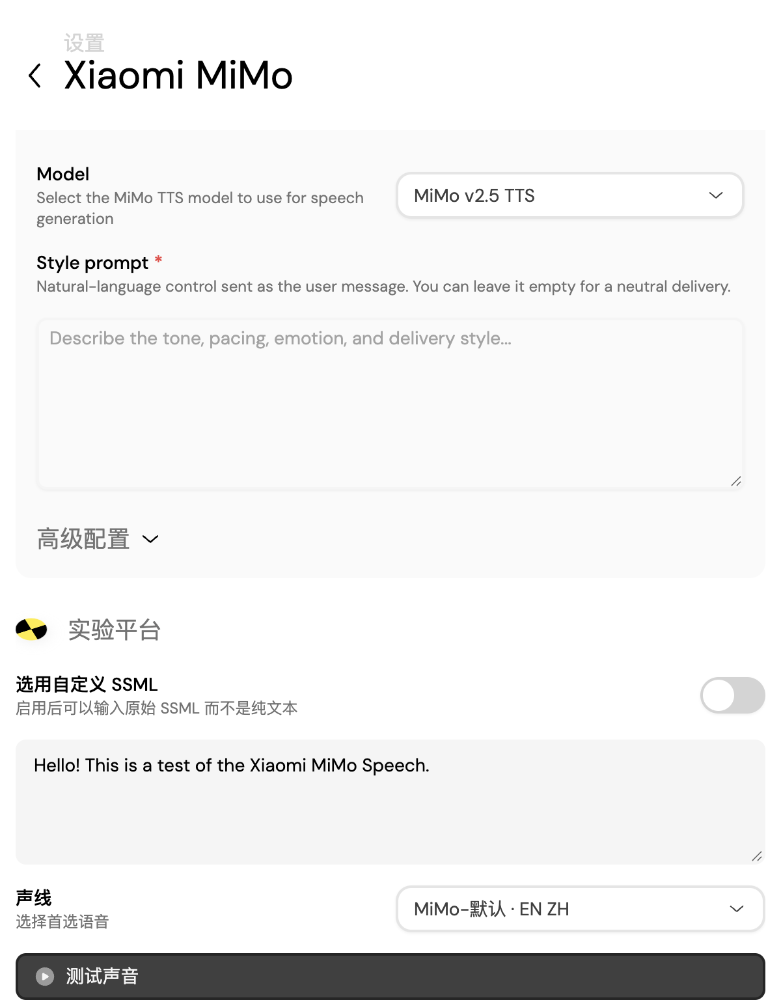

# MiMo 语音密钥检测验证

日期：2026-10-18（Asia/Shanghai）。状态：源码、隔离桌面重启、安装包核对与体验版更新完成。
来源：用户设置页截图、当前主工程与本目录机器日志。
用途：记录本次误判修复，不作为供应商真实账户连通或听感验收。
风险：假密钥、模拟网络和隔离 profile 无法证明真实账户额度、权限与网络。
替代关系：补充语音能力记录，保留原检查的失败与范围。

## 结果

普通配置不保存 API Key 明文。旧 MiMo 页面从普通配置读取 `apiKey`，因此密钥成功加密保存后仍禁用“测试声音”。
新页面通过原安全解析入口计算布尔状态。生成仍走原 MiMo Provider 和音频链。
共享自动校验现在捕获凭据读取失败，设为无效并显示现有本地化校验错误，避免未处理 Promise 异常。

## 验证与边界

| 检查 | 命令 | 结果 |
| --- | --- | --- |
| 修复前复现 | `pnpm -F @proj-airi/stage-pages exec vitest run src/pages/settings/providers/speech/mimo-audio-speech.browser.test.ts` | 3 例在按钮禁用处失败。首次 fixture 提前销毁还产生 2 个异常，随后修正等待初始化 |
| 首修 | 同上 | 4 项断言通过，但存储故障产生 3 个未处理异常。因此没有作为通过结论 |
| 最终页面回归 | `pnpm -F @proj-airi/stage-pages exec vitest run src/pages/settings/providers/speech/{mimo-audio-speech,provider-config-persistence,minimax-speech}.browser.test.ts` | 3 文件、13 例通过，退出 0，无未处理异常 |
| 页面类型 | `pnpm -F @proj-airi/stage-pages typecheck` | 通过，退出 0 |
| 共享 UI 类型 | `pnpm -F @proj-airi/stage-ui typecheck` | 通过，退出 0 |
| 桌面类型 | `pnpm -F @proj-airi/stage-tamagotchi typecheck` | 通过，退出 0 |
| 定向 ESLint | `pnpm exec eslint packages/stage-pages/src/pages/settings/providers/speech/mimo-audio-speech.vue packages/stage-pages/src/pages/settings/providers/speech/mimo-audio-speech.browser.test.ts packages/stage-ui/src/composables/use-provider-validation.ts` | 通过，退出 0 |
| 桌面构建 | `pnpm -F @proj-airi/stage-tamagotchi build` | 通过，退出 0 |
| 全仓类型 | `pnpm typecheck` | 失败，退出 127。可选 scenarios-stage-tamagotchi-browser 缺 node_modules/vue-tsc，未安装依赖掩盖 |
| 全仓 lint | `pnpm lint` | 失败，退出 2。既有 UnoCSS 配置缺 `@radix-ui/colors`，本次定向文件通过 |

测试使用实际 Vue、Pinia、浏览器 DOM、配置存储和 MiMo 适配器，只替换秘密存储平台与外部 fetch。
验证假密钥保存、状态重建后读取、存储失效禁用和 `api-key` 请求头。Pinia 与 localStorage 不包含假密钥。
重建 Pinia 是浏览器内的持久化检查，不等于独立 Electron 进程重启。包内实跑单独记录。
存储故障和相邻 MiniMax fixture 的预期控制台错误保留在原日志，未隐藏。真实凭据、聊天和私人 profile 未读取。

## 包内与安装结果

- 版本：`0.12.0-beta.5+aimy.20261018.3`。
- 与当前桌面构建逐字节核对 1,380 文件。主进程只有既定预览包的自动更新关闭覆盖。
- 保留 `ai.aimy.preview`、`Aimy-Preview`、桌面入口及手动 VRM 身体动作。
- 包内不含 `.env`、`provider-secrets.json`、`credential-binding.json` 或用户指定角色资产。
- 独立 Electron 进程使用临时 appData 和独立内部服务端口。外部网络与权限请求被阻止。
- 从原 UI 打开设置，用假密钥保存后，原生辅助功能和 DOM 都确认“测试声音”可用，缺密钥提示消失。
- 停止该进程后，用同一个隔离目录重启。未再次输入密钥，测试按钮恢复可用，普通 localStorage 无假密钥。
- 重启检查中的直接页面导航等候先超时，随后页面初始化完成。最终原生状态、DOM 布尔证明与截图一致，原结果未丢弃。
- 已安装 `/Users/mima1234/Applications/Aimy体验版.app`，新包 SHA256 为 `fb0c506eaaade067530f8cbb4d412984c27a96bd6791493c239a205006a947f8`。
- 新旧包独立保留。备份：`/Users/mima1234/Applications/Aimy体验版-20261018-MiMo修复前.app`。
- 替换前 SIGTERM 未使原程序退出，安装器停止且没有替换。随后通过原生 Cmd-Q 正常退出后完成替换。
- 安装包的 ad-hoc 签名通过 `codesign --verify --deep --strict`，已重新启动用户体验版，原生主窗口的 Loading 状态已消失。
- 安装器未读取或修改私人资料目录。没有真实 MiMo 请求，没有借用其他模型验收预算。

最终类型检查在所有代码修复完成后对三个工作区再次执行，退出 0，见 `final-types.log`。

