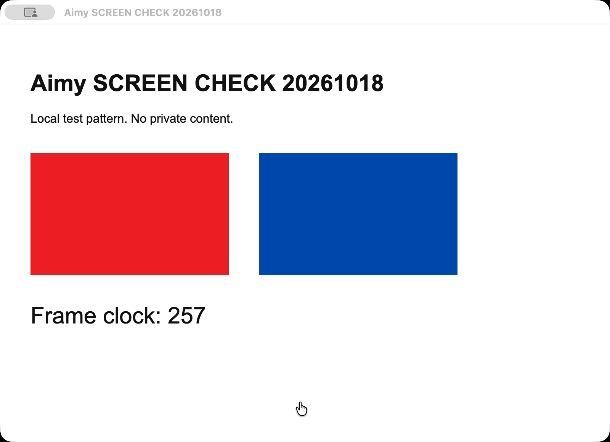

# 屏幕捕捉验证

日期：2026-10-18（Asia/Shanghai）。状态：本地捕捉和停止通过，已恢复普通启动。
来源：用户反馈无法看屏，随后说明已开启录音和录屏系统权限，要求再次验证。
用途：区分系统授权、本地视频捕捉、视觉推理和聊天上下文。
风险：本地画面通过不证明远程视觉模型可读图，也不证明聊天已收到屏幕上下文。
替代关系：补充现有视觉能力证据，不修改此前记录或授权产品实施。

## 当前结论

- 已安装版本为 `aimy.20261018.3`，安装包 SHA256 与验证开始一致。没有修改产品代码、安装包或模型配置。
- 权限更新后，实际 Aimy 主进程通过既有 Eventa 接口返回：`screen=granted`、`microphone=granted`。
- 应用内采集授权独立于系统授权。本次重启后的 screen 和 microphone 开关均为 false，符合默认关闭策略。
- 临时开启应用内 screen 授权后，工作台能列出屏幕和应用窗口。
- 通过工作台实际 Share Window 按钮，选择自建的 `Aimy SCREEN CHECK 20261018` 窗口。
- 实际视频为 1600×1160，readyState=4，视频轨道 live。没有音频轨道。
- 间隔 650 ms 的两次像素哈希不同。红蓝测试块像素正确，时钟可见，排除了黑屏和静态缩略图。
- 停止看屏后，两处引用的同一视频轨道均为 ended，活跃视频数为 0。
- 测试没有启动 ticker，视觉推理数和上下文发布数为 0，没有向外部模型发送截图。
- 未录音。麦克风只检查系统授权状态，不把授权存在当作录音、识别或连续语音已通过。

## 聊天看屏边界

当前选择为 `vision-deepseek / deepseek-v4-pro`，未改变这些设置，也没有调用该账号做读图验证。
视觉模型“已选择”不自动开始屏幕捕捉。视觉设置页主要负责图片路由、模型选择和捕获频率。
当前屏幕处理入口在「设置 → 系统 → 开发者 → Vision Capture」。
本次观察到 `Start ticker` 未启动，`Publish to character` 为关闭。
Share Window/Share Screen 仅打开本地预览。Start ticker 才运行视觉推理。
只有启用 Publish to character，成功推理的结果才由原上下文通道进入角色聊天。
该流程会向用户配置的视觉供应商发送所选画面，并可能计费。本次没有执行。
不能据本记录宣称指定视觉模型连通、图片能力或聊天回答正确。

## 入口与过程说明

初次通过正常设置菜单进入视觉设置与开发者工作台，观察到系统录屏已允许而应用内授权未开。
`WithScreenCapture.vue` 将应用内授权未开也显示为系统录屏权限提示，提示未区分这两层。
该提示差异是源码与运行观察，本轮仅验证，没有修改提示或权限策略。
用户更新系统权限并重新启动后，诊断通过既有打开设置窗口的 Eventa 接口直接进入工作台。
捕捉仍由实际页面 Share Window 按钮和原屏幕捕捉实现完成，没有替换 loader 或媒体 API。

临时测试辅助窗口先出现初始化和钥匙串等待。修正临时启动脚本后，用 mock keychain 启动仅含合成数据的辅助窗口。
Aimy 实际应用的安全存储与钥匙串策略没有变化。工具没有读取密码、API Key 或聊天内容。
测试只保留无隐私测试窗口的帧，不保存真实桌面截图。
验证结束关闭辅助窗口和本地诊断连接，正常重开原体验版，主窗口已恢复。
macOS 系统录音/录屏授权保留，应用内临时采集已关闭。

## 定向自动测试

| 检查 | 实际命令 | 结果 |
| --- | --- | --- |
| 捕捉 host 授权与过期结果 | `pnpm exec vitest run --config <临时 capture-vitest.config.mts>`，只包含 `packages/electron-screen-capture/src/main/index.test.ts` | 1 例通过 |
| Electron 权限与采集生命周期 | `pnpm -F @proj-airi/stage-tamagotchi exec vitest run --config vitest.node.config.ts src/main/services/electron/media-permissions.test.ts src/main/services/aimy/resource-lifecycle.test.ts` | 36 例通过 |
| 视觉推理与上下文编排 | `pnpm -F @proj-airi/stage-ui exec vitest run src/stores/modules/vision/orchestrator.test.ts src/composables/vision/use-vision-inference.test.ts` | 11 例通过 |

总计 48 例通过。这些是原有测试，外部模型使用模拟边界，不能替代真实账号效果。
第一次从没有独立 Vitest 配置的 screen-capture 包目录运行时，根项目路径解析失败。
之后用临时最小配置运行原测试，未改仓库配置，失败原日志保留。
本次未修改产品源码，因此没有重新构建或运行全仓类型/lint。

原始证据：`summary.json`、`capture-proof.json`、`stop-proof.json`、测试日志与截图。
临时诊断目录：`/var/folders/r7/gs0cbny53rz391_2ht9swv300000gn/T/aimy-screen-verify-20261018-cyj93ygh`。
