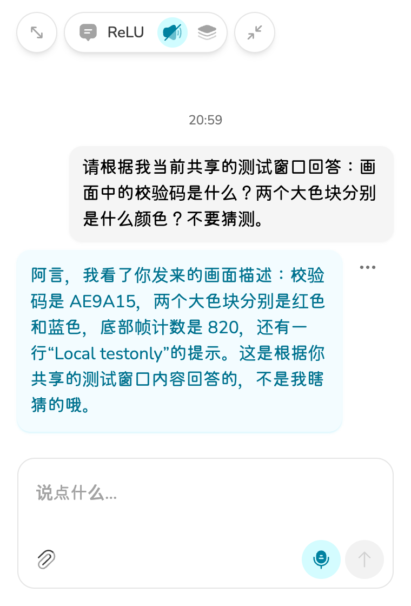

# 视觉鉴权与真实聊天验证

日期：2026-10-18（Asia/Shanghai）。状态：真实读屏、聊天回答及新进程配置恢复通过。
来源：用户的 401 截图、本次实际体验版、DeepSeek 官方文档和真实请求结果。
用途：验证屏幕捕捉、远程读图、上下文发布和角色回答的完整链路。
风险：本次只有一个合成窗口案例，不能代表任意屏幕、复杂图表或长期稳定性全部通过。
替代关系：补充此前只验证本地画面的记录，不改写其未做模型调用的事实。

## 两个故障点

1. 视觉与聊天有独立 Provider 配置。聊天 `deepseek` 能取得非空加密 Key，`vision-deepseek` 的加密配置中 Key 为空。
   视觉请求发出时没有有效鉴权，符合用户截图的 401。工具只获取存在性布尔值。
2. 视觉选择为 `deepseek-v4-pro`。复用用户明确批准的聊天 Key 后，HTTP 返回 200，但模型表示图像不支持或未加载。
   官方能力表明确 Pro 不支持 Vision，`deepseek-flash` 支持。

已按用户选择通过原加密配置动作复用聊天 Key。视觉模型改为 `deepseek-flash`，聊天仍为原 `deepseek-flash`。
API Key 不进入工具输出、仓库、同步状态或截图。没有重新输入、生成或轮换供应商密钥。

官方来源：[模型能力表](https://api-docs.deepseek.com/quick_start/pricing/)、[Vision 输入说明](https://api-docs.deepseek.com/guides/vision/)。

## 真实验证

自建无隐私窗口有随机校验码 `AE9A15`、红蓝两个色块和动态计数。答案只存在于被捕捉画面。
通过体验版原 Share Window 按钮捕捉 1600×1160 视频，取帧后走原视觉编排与上下文通道。
使用原 Provider 工厂、原 `processCapture` 和原聊天 store，没有构造另一套聊天运行时。
工作台通过原 Eventa 打开设置窗口接口直接进入。聊天请求从原聊天 action 发起，随后核对实际聊天窗口。

| 请求 | 模型 | 结果 |
| --- | --- | --- |
| 1 复用凭据后的原模型 | deepseek-v4-pro | HTTP 200，未读出图像，作为失败保留 |
| 2 正确视觉模型 | deepseek-flash | HTTP 200，正确读出 AE9A15、红蓝块、计数和窗口文字，发布 1 次上下文 |
| 3 角色聊天 | deepseek-flash | HTTP 200，回答正确，原聊天窗口可见 |

用户测试问题：

> 请根据我当前共享的测试窗口回答：画面中的校验码是什么？两个大色块分别是什么颜色？不要猜测。

角色回答包含：

> 校验码是 AE9A15，两个大色块分别是红色和蓝色，底部帧计数是 820。

用户问题没有校验码或颜色答案。聊天出站请求中含视觉通道提供的校验码，用户问题本身不含答案。
聊天请求没有原始图片部件，证明本例通过视觉描述进入聊天，不是把答案写进问题。
真实请求合计 3 次，未读取供应商账单，不能给出精确实扣金额。没有借用以前文字记忆验收预算。

## 清理与持久化

- 独立临时测试会话避免读取或发送原会话历史。
- 测试时暂时使用 speech-noop，未产生 TTS 调用。测试后恢复原语音 Provider。
- 通过原内存 deferral 暂停后台记忆工作。删除仅本次创建的测试会话与对应来源后再解除暂停，记忆启用策略未改变。
- 原会话恢复。测试窗口关闭，所有测试视频轨道结束。真实桌面与私人页面未发送给模型。
- 第一次仅改变运行 store 时，重启从角色卡恢复旧 Pro 模型，因此没有把那次持久化写成通过。
- 视觉选择的持久 owner 是角色卡。最终通过原 `updateActiveCardVision` 保存，并再次检查新进程。
- 本次没有改产品源码或安装包，版本仍为 `aimy.20261018.3`。

## 检查边界

真实画面、实际 HTTP 返回、上下文到达和聊天可见分别保留证据。
本例证明校验码与色块读屏问答通过，不证明其他应用页面的细节识别、自动持续看屏或动作协调。
没有重跑源码类型检查或自动测试，因为没有修改产品源码。
按仓库要求执行 `pnpm lint`，退出 2。既有 UnoCSS 配置缺 `@radix-ui/colors`，见本目录日志。未为此安装依赖或扩展修复。

原始证据包括 `credential-presence.json`、`resolved-presence.json`、`configuration-repair.json`、三次真实结果、`acceptance.json`、`cleanup.json` 和截图。

最终新进程复核：角色卡和运行 store 均为 `deepseek-flash`，视觉加密 Key 非空，普通配置无明文 Key，聊天模型不变。见 `final-restart-proof.json`。

已关闭仅绑定本机的诊断端口，普通模式重新启动。测试结束的屏幕采集保持关闭，继续使用时需由用户重新共享来源并启动 ticker。
