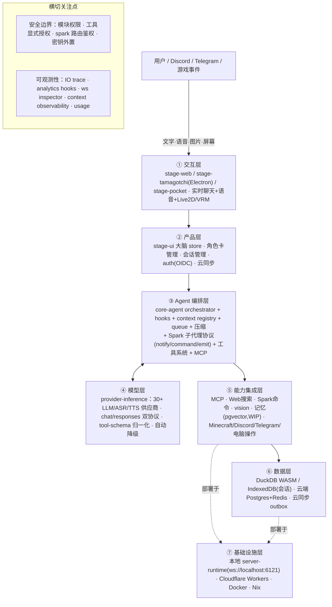

# AIRI 参考项目 · 拆解报告 与 反推 PRD

> 文档状态：历史归档，不作为当前需求、技术选型或开工依据。
> 产物时期：初稿日期未知；2026-10-07范围纠正；针对旧aimy/airi-main。精确初稿时间未记录时保持未知。
> 保留原因：保存早期选AIRI的来源和核心147tests证据。
> 上下文风险：生产级/全覆盖/全部能力/pgvector等旧断言已被纠正；旧路径版本同名不能替代10-10新来源。
> 原位置：`AIRI-参考项目-拆解与反推PRD.md`；归类整理：2026-10-11。
> 阅读入口：[文档中心](../../README.md)。历史正文中的“当前、唯一、已锁定、下一步”仅适用于原时期。

> **历史 AIRI 拆解：范围纠正于 2026-10-07。** 本文针对当时本地 `airi-main` 的源码与核心包测试，不作为 Aimy 当前需求、产品完成度或全平台验收。当前产品总纲见 [PRD-MVP-重构版](../旧Aimy样机/设计与需求/PRD-MVP-重构版.md)，进度及新验证见 [PROJECT_STATE](../../PROJECT_STATE.md)。以下正文和测试数字保留历史，不宣称官方最新版本已重新验证。
>
> **失效或需收紧的结论：** “全能力生产级”“可实现全部需求”“Vitest 全覆盖”及整体六项验收通过均不能由 core-agent 147 项测试推导。语音打断/回声、看屏及时性、长期记忆、真实设备/模型、隐私关闭和安装体验需要分别实测；已有源码/演示不等于成熟产品能力。旧组件合计与表内判定不一致，不使用旧统计推导完成率。
>
> **存储及路径纠正：** 本地 AIRI 会话链路使用 IndexedDB；`duckdb-wasm`、`drizzle-duckdb-wasm` 两目录只有迁移说明，不能当作已接入的本地数据库。电脑操作与其他集成的历史路径须按当前源码核对，缺失文件不作为能力证明；Aimy 一期不接电脑自动操作。`memory-pgvector` 的历史缺口不自动意味着应引入云端 pgvector，Aimy 先验证本地记忆闭环。
>
> 下文的技能、任务、目标闭环与游戏建议为当时探索，不能直接变成 Aimy 一期新增需求。根底座、平台配置与供应商能力各自验证，继续按批准的 A–E 路线执行。

> 拆解对象：`/Users/mima1234/Documents/aimy/airi-main`（Project AIRI，`moeru-ai/airi`，v0.12.0-beta.5）
> 拆解方法：按《Agent Blueprint》（BLUEPRINT.md）的「五步 SOP + 八问 + 五要素 + 七层架构 + s01–s17 组件库 + 六条验收标准」执行
> 执行方式：本报告由当前 AI 按手册人工分析（已实读源码 + 实际安装依赖、构建并运行核心 Agent 测试），**未调用外部模型管线**；文中"模型审稿/占位"类结论一律不适用，全部结论有源码/命令证据。

---

## 0. 执行摘要（TL;DR）

**AIRI 是什么**：一个「AI 虚拟角色 / 数字生命」的灵魂容器（复刻 Neuro-sama）——让用户拥有一个能在浏览器 / 桌面 / 手机 / Discord / Telegram / 游戏里「聊天、看屏幕、说话、玩游戏、被定时唤醒」的 AI 角色。

**它是不是 Agent Harness 产品**：**是，而且完成度很高。** 它是把「Agent Loop + 工具 + 钩子 + 上下文 + 记忆(部分) + 子代理 + MCP + 权限(模块级)」全部塞进一个单进程可运行的 Vue/TS 载具里的生产级样本。对照蓝图的 17 个组件，**强/中 15 项，弱 2 项（s07 技能加载、s09 记忆系统）**，另有 2 项是「有雏形但不是完整实现」（s05/s10 任务系统、s17 目标闭环）。

**本次实际跑通的代码**（有命令证据）：

```sh
cd /Users/mima1234/Documents/aimy/airi-main
pnpm install --ignore-scripts                 # ✅ 13s，安装 2600+ 依赖
pnpm -F @proj-airi/core-agent build           # ✅ 构建 Agent 内核
# 补齐工作区依赖 dist（plugin-protocol/provider-inference/server-sdk/server-shared/stream-kit/pipelines-audio/audio/better-ws）
pnpm -F @proj-airi/core-agent exec vitest run # ✅ 21 个测试文件 / 147 个用例全部通过
```

核心结论一句话：**AIRI 的「大脑」是一个高度工程化的 Agent Harness；你二次开发时可以复用它的骨架，但要重点补「记忆 / 技能 / 任务 / 目标闭环 / 工具审批」这五块。**

---

## 1. 项目全局预览

### 1.1 定位与产品形态

- 一句话：**「让用户拥有属于自己的数字生命」** —— 复刻 Neuro-sama，做开源、可自部署的 AI waifu / 虚拟角色 / 数字宠物。
- 与 c.ai / SillyTavern 的区别：不止聊天，还能**玩游戏、看屏幕、听/说、定时自主行动、多端协作**。
- 三个正式 App + 一套文档站：
  - `apps/stage-web`：浏览器版（Vue 3 + Vite + WebGPU/WebAudio/WebWorker）
  - `apps/stage-tamagotchi`：桌面版（Electron）
  - `apps/stage-pocket`：移动版（Capacitor，实验性）
  - `docs`：VitePress 文档站（多语言）
- 后端与集成：
  - `server/`：托管后端（Hono API + Better Auth/OIDC + PostgreSQL + Redis）
  - `packages/server-runtime`：**本地 WebSocket 频道服务器**（`ws://localhost:6121`），连接各"模块/插件/集成"
  - `integrations/`：discord-bot、telegram-bot、minecraft、satori-bot、twitter-services、vscode
  - `services/computer-use-mcp`：电脑操作 MCP（含 Chrome 扩展）

### 1.2 Monorepo 关键包（按职责）

| 包 | 职责 | 对应蓝图层 |
|---|---|---|
| `packages/core-agent` | **Agent 内核**：编排运行时、LLM 流、钩子、上下文注册表、压缩、Spark 子代理 | ③ 编排层 |
| `packages/provider-inference` | 30+ LLM/ASR/TTS 供应商适配、工具 schema 归一化、运行时矩阵 | ④ 模型层 |
| `packages/plugin-protocol` | **模块/插件协议**：announce→prepare→configure→contribute，权限声明/请求/授权，Spark 事件 | ③/⑤ 横切 |
| `packages/stage-ui` | **产品层**：chat 大脑 store、角色卡、会话、上下文、工具、MCP、vision/hearing/speech | ② 产品层 |
| `packages/server-sdk / server-shared / server-runtime` | WebSocket 客户端 SDK / 共享类型 / 频道服务端 | ⑦ 基础设施 |
| `packages/stage-ui-three / live2d / mmd / spine / tachie` | 渲染（3D/VRM/Live2D/MMD/Spine/立绘） | ① 交互层 |
| `packages/pipelines-audio / audio` | 音频流水线（ASR→LLM→TTS 实时链） | ①/⑤ |
| `packages/memory-pgvector` | 记忆服务（**目前是空壳 stub**，见 §5） | ⑥ 数据层 |
| `packages/drizzle-duckdb-wasm / duckdb-wasm` | 浏览器内嵌数据库（本地优先） | ⑥ 数据层 |

### 1.3 运行方式（入口）

```sh
pnpm dev                 # stage-web（浏览器版）
pnpm dev:tamagotchi      # 桌面版 Electron
pnpm dev:pocket:ios      # 移动版
pnpm dev:docs            # 文档站
pnpm dev:server          # 本地 WebSocket 频道服务器
pnpm -F @proj-airi/core-agent exec vitest run   # Agent 内核测试（本次已跑通）
```

---

## 2. 反推 PRD（按蓝图八问拆解）

### 2.1 产品定位（一句话）

> **AIRI 是一个开源、可自部署的 AI 虚拟角色"灵魂容器"（AI VTuber / 数字生命），让角色能聊天、听、说、看屏幕、玩游戏、定时自主行动，并接入 Discord / Telegram / Minecraft 等外部世界。**

### 2.2 八问拆解

| # | 蓝图问题 | 反推结论（证据） |
|---|---|---|
| 1 | 要达成什么 | 让用户拥有一个**随时随地、能看能听能说能动手**的 AI 角色；复刻 Neuro-sama 的能力边界（README + Roadmap：Brain/Ears/Mouth/Body 四域） |
| 2 | 给谁用 | ① 普通用户（下载桌面/浏览器/手机版，导入角色卡即用）；② 开发者（插件/模块/集成生态，自定义能力）。交互：**同步聊天 + 异步事件（spark:notify 定时唤醒）** |
| 3 | 一次完整交付 | 用户输入（文字/语音/图片/屏幕）→ 组装上下文（角色卡 + 会话历史 + 运行时上下文）→ LLM 生成（可调工具）→ 文本/语音/动作/子代理命令回传 → 持久化 + 云同步 |
| 4 | 需要什么外部动作 | 聊天（LLM）、语音识别/合成（ASR/TTS）、视觉理解（Vision）、画面渲染（Live2D/VRM/3D）、外部工具（MCP、Web 搜索、电脑操作）、外部系统（Discord/Telegram/Minecraft/Factorio/HomeAssistant 等）、云同步（API/WS） |
| 5 | 领域知识在哪 | **角色卡（CCv3）**：system_prompt + description + personality + scenario + first_mes + mes_example；运行时上下文（context registry）；模块/插件注入的提示词（toolset prompts）；Web 搜索的安全提示词 |
| 6 | 什么绝对不能做 | 未授权广播（spark 事件要求 destinations 路由 + auth/capability 检查）；工具越权（`requiresExplicitSelection`、MCP 需显式选择）；Web 内容不能当指令（prompt-injection 防护）；密钥不外泄（.env / provider 配置） |
| 7 | 失败怎么办 | LLM 流失败 → 自动降级（工具不支持→关工具重试；content-array 不支持→转字符串重试一次）；超时 → AbortController 中止；会话过期 → generation 校验拒绝陈旧发送；离线 → outbox 重试；云删失败 → tombstone 防复活 |
| 8 | 怎么算成功 | 有埋点（activation / message round / latency / usage / 会话创建删除 / 卡片创建）与 IO 追踪（trace span），但**尚无明确"质量门/目标达成判定器"**（即 s17 目标闭环缺失） |

### 2.3 需求硬事实表（Step 1 产出）

| 维度 | 结论 | 状态 |
|---|---|---|
| 目标 | 开源 AI 虚拟角色灵魂容器，复刻 Neuro-sama 能力 | 明确 |
| 用户 | 终端用户（聊天/陪伴/看直播）+ 开发者（插件生态） | 明确 |
| 核心闭环 | 输入(文字/语音/视觉/事件) → 上下文组装 → 模型(可调工具) → 输出(文本/语音/动作/命令) → 持久化 | 明确 |
| 交付物 | 实时角色交互（语言 + 形象动作 + 外部系统操作） | 明确 |
| 边界 | 不碰未授权广播；工具/数据需显式授权；Web 内容与指令隔离 | 明确 |
| 约束 | 需同时支持浏览器/桌面/移动；本地优先（可离线）；多 LLM 供应商兼容；可自部署 | 明确 |

### 2.4 Harness 五要素清单（Step 2 产出）

| 要素 | AIRI 的实现（证据文件） |
|---|---|
| **工具 Tools** | xsai 工具系统（`llm-tools` store + `resolveLlmTools`）；内置 `builtIn_emitSparkCommand`、`builtIn_mcpListTools/mcpCallTool`、Web 搜索、debug；MCP 工具桥（`stores/mcp-tool-bridge.ts`、`tools/mcp.ts`） |
| **知识 Knowledge** | 角色卡 CCv3（`stores/modules/airi-card.ts` `resolveSystemPrompt`）；运行时上下文（`stores/chat/context-store.ts` + `core-agent context-registry`）；toolset 提示词（`ai/chat-llm/toolset-prompts.ts`） |
| **观察 Observation** | 视觉模块（屏幕截图→Vision 推理→上下文，`modules/vision/orchestrator.ts`）；IO 追踪（`use-io-tracer`）；WebSocket 事件观察（`devtools/websocket-inspector`）；游戏状态（minecraft/factorio context:update） |
| **行动 Action** | LLM 流式生成（`core-agent llm-service`）；语音输出（`speech-runtime`）；Spark 命令下发子代理（`spark:command`）；MCP 工具调用；云同步 push |
| **权限 Permissions** | 模块权限协议（`plugin-protocol` module:permissions:*）；工具显式选择（`requiresExplicitSelection`）；Spark 事件路由/鉴权；认证（auth + token） |

---

## 3. 架构解析（对应蓝图七层）



**一条贯穿数据流**：用户输入进入交互层 → 产品层把输入交给 `chat` store（Pinia 的 `send`）→ 编排层 `createChatOrchestratorRuntime.ingest` 进入 FIFO 队列 → 组装 `Conversation`（角色卡系统提示词 + 会话历史 + 运行时上下文 + 时间戳前缀 + 回复引用）→ 模型层 `streamFrom` 选择协议适配器流式生成 → 工具调用经 `resolveLlmTools` 合并（内置 + MCP + Spark 命令 + 运行时注册）执行并回灌 → 结果经 hook 链、语音渲染、轨迹采集落库 → 云同步。

### 3.1 关键机制逐个说清

1. **Agent Loop（s01）**：`core-agent/src/runtime/chat-orchestrator-runtime.ts`（1114 行）——单例运行时，含 FIFO 发送队列、会话 generation 防陈旧、AbortController 取消、流式状态镜像、10 个 hook 阶段、Telemetry 埋点。底层 `llm-service.ts` 的 `streamFrom` 完成真正的「消息→模型→工具→结果→循环」（Chat/Responses 双协议，`waitForTools` 处理多轮工具调用）。
2. **钩子系统（s04）**：`agent-hooks.ts` 定义 `onBeforeMessageComposed / onAfterMessageComposed / onBeforeSend / onAfterSend / onTokenLiteral / onTokenSpecial / onStreamEnd / onAssistantResponseEnd / onAssistantMessage / onChatTurnComplete` 十个扩展点，插件可订阅/退订。
3. **上下文系统（s08）**：`context-registry.ts` 维护按 sourceKey 分桶的运行时上下文，支持 `replace-self` / `append-self` 两种策略，历史上限 400；`compaction.ts` 对超长历史做分层压缩（保留最近 N 轮 + 摘要）。
4. **Spark 子代理协议（s06/s13 雏形）**：`plugin-protocol/src/types/events.ts` 定义三事件：
   - `spark:notify`（子代理→角色：alarm/ping/reminder，带 urgency）
   - `spark:command`（角色→子代理：interrupt/priority/intent/guidance/persona/contexts/destinations）
   - `spark:emit`（双向 ack/进度/状态）
   - 角色侧由 `character/orchestrator` 用 2 秒 ticker 调度，`spark-notify` agent 决定「回复文本」或「下发命令」。**这是 AIRI 最独特的机制：把"角色"当作总代理，把"游戏/IM/智能家居"当作可路由的子代理。**
5. **模块/插件协议（s03/s14）**：`plugin-protocol` 的模块生命周期 `announce→prepare→configure→contribute:capability→ready`，以及**权限系统** `module:permissions:declare/request/granted/denied/current`。
6. **角色卡（知识载体）**：`airi-card.ts` 把 CCv3 角色卡映射为 AIRI 扩展，`resolveSystemPrompt` 拼出系统提示词；每张卡可绑定独立的 consciousness/vision/speech/显示模型。
7. **记忆（s09，最大缺口）**：目前只有 ① `character/notebook.ts`（笔记/日记/焦点 + 定时任务）；② 会话持久化（IndexedDB + 云同步）；③ `memory-pgvector` **空壳 stub**（只有 `new Client({name:'memory-pgvector'})`）。Roadmap 标注「Memory Alaya WIP」。

---

## 4. 组件选型对照（s01–s17 映射表）

> 判定：✅ 强 / 🟡 有雏形 / ❌ 无

| 组件 | 判定 | AIRI 现状与证据文件 |
|---|---|---|
| s01 Agent Loop | ✅ | `chat-orchestrator-runtime.ts` + `llm-service.ts streamFrom`（工具循环、FIFO 队列、取消、重试） |
| s02 工具系统 | ✅ | `llm-tools` store + `resolveLlmTools`（注册/去重/覆盖）+ xsai schema |
| s03 权限系统 | 🟡 | 有**模块级权限协议**与工具显式选择；但**缺"破坏性操作审批管道 / 默认拒绝"**的对话级工具审批（工具要么 allow 要么需显式选，没有 ask→人工确认流） |
| s04 钩子系统 | ✅ | `agent-hooks.ts` 十个钩子，前置可阻断 |
| s05 任务规划 | 🟡 | `notebook.ts` 有 ScheduledTask（queued/scheduled/done/dropped + dueAt），但**无"先计划后执行"的 todo/plan 持久化与进度查询**，也无依赖图 |
| s06 子 Agent | ✅ | **Spark 协议**（notify/command/emit + destinations + persona + guidance + interrupt/priority），角色作为总代理调度子代理 |
| s07 技能加载 | ❌ | **无**运行时技能系统（无 SKILL 目录/按需展开/版本管理）；仓库里 `.agents/skills` 是开发者技能，非产品运行时技能 |
| s08 上下文压缩 | ✅ | `compaction.ts` 分层压缩 + context registry 有界（400）+ 会话摘要 |
| s09 记忆系统 | ❌ | `memory-pgvector` 是空壳；无「筛选→提取→整合」三子系统、无 embedding 检索；仅 notebook + 会话持久化（Roadmap：Memory Alaya WIP） |
| s10 任务系统 | 🟡 | 有简单任务队列/定时任务，但**无依赖图、无原子状态变更的完整任务系统、无断点续跑** |
| s11 后台任务 | ✅ | `createQueue`（stream-kit）+ 发送队列 + 云同步 outbox + spark 通知调度（线程/timer + 完成通知注入） |
| s12 定时调度 | ✅ | `character/orchestrator` 2s ticker + `computeNextRunAt` + urgency 分级 + 重试/上限 |
| s13 Agent 团队 | 🟡 | Spark 是"命令总线"式多代理，**无持久队友/worktree 隔离/原子认领/类型协议**（s13 的完整团队模型未实现） |
| s14 MCP 插件 | ✅ | `tools/mcp.ts`（listTools/callTool 代理）+ `mcp-tool-bridge` + `services/computer-use-mcp` |
| s15 集成 Harness | ✅ | core-agent 单循环集成 hooks/context/tools/queue/子代理 |
| s16 工作流运行时 | ❌ | 无固定编排脚本/journal 续跑的工作流运行时 |
| s17 目标闭环 | 🟡 | 无独立「何时算完成」评估器（有 response-categoriser、analytics，但非目标判定器） |

**合计：✅ 10 / 🟡 5 / ❌ 2**（s07 技能加载、s09 记忆系统为明确缺失；s16 工作流运行时定位为"该产品形态暂不需要"）。

---

## 5. 是否符合 Agent Harness 产品 + 优化方案与优先级

### 5.1 结论

**AIRI 是标准的 Agent Harness 产品，而且是"骨架→硬化→产品化"三层里的"产品化"级别。** 它把蓝图的第 3 层（编排）和第 4 层（模型）做得极扎实，横切的可观测性与可测试性也到位。真正落后的是**认知域与记忆域**（s07/s09）以及**任务/目标闭环**（s05/s10/s17）。

### 5.2 强项（二次开发应直接借鉴）

1. **编排运行时与钩子解耦**：`createChatOrchestratorRuntime` 通过 Ports（session/context/stream/llm）注入平台能力，核心逻辑与 Vue/Pinia 解耦，可直接移植。
2. **协议先行的多代理设计**：Spark 事件 + 模块生命周期 + 权限协议都在 `plugin-protocol` 里用类型定义清楚，是教科书级的扩展边界。
3. **工具解析的健壮性**：`resolveLlmTools` 的五源合并（MCP/debug/spark/web-search/custom/active）+ 去重 + 供应商 schema 兼容性降级，值得照抄。
4. **本地优先 + 云同步**：IndexedDB/DuckDB + outbox/tombstone 的离线优先设计。
5. **可观测性前置**：从第一行就埋 IO trace、analytics、usage、生命周期事件。

### 5.3 缺口与优化方案（按优先级）

#### P0（决定"是否可信赖、可长期使用"）

| 缺口 | 问题 | 优化方案（具体落点） |
|---|---|---|
| **s09 记忆系统** | `memory-pgvector` 是空壳；角色无法跨会话"记住偏好/事实/决策"，只能靠会话历史硬塞 | ① 落地 `memory-pgvector`：建 `memories` 表（id/embedding vector/content/metadata/created_at），接 pgvector；② 在 core-agent 增加「筛选→提取→整合」三阶段（会话结束时从 `ChatTurnComplete` 钩子提取候选记忆，去重后入库，检索时按相关度注入上下文）；③ 检索接入 `context-registry` 作为 `memory` 桶（`replace-self`） |
| **s03 工具审批管道** | 破坏性工具只有"显式选择"，无"运行前人工确认" | 在 `llm-tools` 的 `ExecutableTool` 增加 `permission: 'allow'\|'ask'\|'deny'`；`resolveLlmTools` 对 `ask` 工具生成"确认工具调用"回执，UI 弹审批，通过后才执行；默认拒绝未登记副作用工具 |

#### P1（决定"能不能规模化、能不能交付复杂任务"）

| 缺口 | 问题 | 优化方案 |
|---|---|---|
| **s05/s10 任务系统** | 任务只是简单数组，无依赖图、无断点续跑 | 把 `notebook.ts` 的 `ScheduledTask` 升级为带 `dependencies[]`、`status 机`、`progress`、持久化的任务图；给 LLM 加 `builtIn_taskPlan/builtIn_taskUpdate` 工具，落盘 JSON，支持中断续跑 |
| **s17 目标闭环** | 角色不知道"任务何时算完成" | 增加独立评估器（复用 `response-categoriser` 的独立请求），对每条任务输出 `done/blocked/more`；`blocked` 时通过 `spark:emit` 交还用户，`more` 时续跑 |
| **s07 技能加载** | 领域知识只能靠角色卡，无法按需注入 | 参考引擎的 `s07_skill_loading`：建 `skills/<domain>/SKILL.md`，目录先行、正文惰性加载；工具触发或意图匹配时注入对应技能正文到 context |

#### P2（锦上添花，按产品形态取舍）

| 缺口 | 优化方案 |
|---|---|
| **s13 Agent 团队**（如需真正的多人协作） | 在 Spark 协议上加"持久队友注册表 + worktree 绑定 + 原子认领 + 类型化消息协议" |
| **s16 工作流运行时**（如有固定编排流程） | 引入 journal 化脚本编排；否则**维持现状（放弃），不强加** |
| **记忆/工具的成本护栏** | 参考引擎的 Budget：max_calls / max_tokens 双上限，超限即停并提示 |

### 5.4 六条验收标准对照

| 标准 | 判定 | 证据 |
|---|---|---|
| 可运行 | ✅ | `pnpm dev` 一条命令；配置外置（`.env` / provider 配置） |
| 可容错 | ✅ | 工具降级重试、content-array 降级、Abort、超时、离线 outbox、tombstone |
| 可观测 | ✅ | IO trace、analytics hooks、usage、ws inspector、context observability |
| 可测试 | ✅ | Vitest 全覆盖，core-agent 147 用例通过（本次实测） |
| 可部署 | ✅ | Electron builder / Docker / Cloudflare Workers / Nix / winget/brew |
| 可度量 | 🟡 | 有埋点与用量，但**缺对齐 PRD 的"成功/质量"指标与采集**（需补目标闭环评估器） |

---

## 6. 给二次开发的启示（复用清单，供下一步对齐用）

**直接可复用（高价值）**：
- `core-agent` 的编排运行时 + 钩子 + 上下文注册表（平台无关，可整体搬走）。
- `resolveLlmTools` 的多源工具合并 + 供应商 schema 降级。
- `plugin-protocol` 的模块生命周期 + 权限协议 + Spark 事件（可作为"多代理"底座）。
- `provider-inference` 的多供应商适配层（聊天/ASR/TTS 统一入口）。
- 本地优先 + 云同步的 outbox/tombstone 模式。

**需要重做/补强**：记忆（s09）、技能（s07）、任务（s05/s10）、目标闭环（s17）、工具审批（s03 对话级）。

**架构层面的坑**（参考项目自己留的 TODO）：
- `tool-resolver.ts` 注释明说：Spark `destinations` 目前靠 LLM 猜，经常幻觉，所以**被迫广播给所有模块** —— 子代理路由的可靠性是大坑，二次开发要么做严格 schema 约束，要么做路由解析层。
- `airi-card.ts` 里 `extensions.airi.agents = {}` 还是占位（`// TODO: Minecraft Agent, etc`），说明"每个角色挂多个子代理"的最终形态尚未落地。

---

## 7. 下一步（对齐你的新产品的 PRD）

以上完成了你说的 **1–4 点**（预览 / 跑通 / 反推 PRD / 优化方案与优先级）。接下来进入第 5 点——挖出你要二次开发的那款产品的想法。

在开始前，先回答我一个总问题（不用一次答完，我们先对齐方向）：

1. 你想参考 AIRI 的**哪一部分**做二次开发？是
   - (A) 整个"AI 角色/陪伴"形态（换皮做新角色产品），
   - (B) 它的**Agent 内核/多代理架构**（做另一个领域的 Agent 产品），
   - (C) 它的**某块能力**（语音/视觉/记忆/MCP/游戏），
   - (D) 别的（请一句话描述）。

2. 你的新产品**一句话定位**是什么（给谁用、解决什么问题）？

你先答这两条，我再按蓝图的「八问」一轮轮问你，直到我们把新产品的 PRD 挖出来、写成文档。
