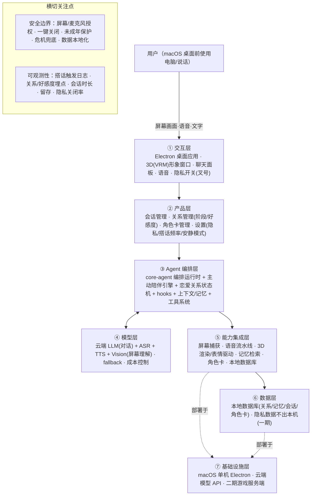

# 数字恋人 · 产品 PRD（v1.0）

> 文档状态：历史归档，不作为当前需求、技术选型或开工依据。
> 产物时期：v1.0/v1.1初稿日期未知；2026-10-07起历史。精确初稿时间未记录时保持未知。
> 保留原因：保存关系五阶段、早期功能取舍和M路线缘由。
> 上下文风险：完整系统提示词、七层架构、s组件和全部锁定容易扩大当前需求；订阅/自建角色/本地不外发/NSFW等已失效。
> 原位置：`数字恋人-产品PRD.md`；归类整理：2026-10-11。
> 阅读入口：[文档中心](../../README.md)。历史正文中的“当前、唯一、已锁定、下一步”仅适用于原时期。

> **历史文档：2026-10-07 起不作为当前需求或开工依据。** 当前唯一总纲为 [Aimy MVP 产品需求总纲](../旧Aimy样机/设计与需求/PRD-MVP-重构版.md)，当前进度与验证见 [PROJECT_STATE](../../PROJECT_STATE.md)。以下正文保留当时愿景、方案和决策记录，不代表现在全部锁定或已实现。
>
> **已被替代的结论：** 一期订阅/免费分层、恋爱五阶段/好感为核心、一期用户自建角色、只包含屏幕/语音的输入、NSFW 轻微或“先开发再定边界”。当前为虚拟情感陪伴，可发展亲密关系；少量受邀用户 BYOK；一个官方 VRM；文字、图片、可打断连续语音与授权看屏；一期不做露骨内容。订阅、云同步、自建角色、游戏内操作/独立游戏及电脑自动操作后置。
>
> **数据与指标纠正：** 本地优先不等于模型请求不出本机；云端 provider 会接收经授权发送的内容。当前本地 AIRI 会话使用 IndexedDB，两个 DuckDB 目录为迁移说明，不是已接入数据库。隐私关闭率不以越低越好作为产品目标，应尊重用户控制。旧“全部 11 项已锁定”与旧 M 顺序失效，按新版 A–E 推进。

> 状态：**PRD 定稿（v1.1，全部锁定）**。
> 参考项目：AIRI（拆解见《AIRI-参考项目-拆解与反推PRD.md》）
> 推导方法：Agent Blueprint 五步 SOP（需求拆解 → 领域建模 → 组件选型 → 架构设计 → 代码生成规划）
> 执行方式：当前 AI 按手册人工分析，未调用外部模型管线。

---

## 一、需求拆解（八问结论）

| # | 问题 | 结论 |
|---|---|---|
| 1 | 要达成什么 | 一款**数字恋人**桌面产品：有真实可动的 3D 形象，能**全主动**看着用户屏幕、理解用户在做什么并实时搭话，能语音/文字聊天、建立**有进度、有好感、有情绪**的恋爱关系；二期接入自研虚拟世界游戏。 |
| 2 | 给谁用 | 需要人机恋、情感陪伴的人。交互：**同步实时陪伴 + 后台常驻**；频率：高频（日常陪伴型）。 |
| 3 | 一次完整交付 | 用户在使用电脑（或主动说话）→ 角色观察屏幕/听到语音 → 理解上下文 → 决定是否搭话 → 生成带情绪的语言/表情/动作 → 用户回应 → 关系与记忆更新 → 持久化。 |
| 4 | 需要什么外部动作 | 屏幕捕获（一期整屏）、语音识别 ASR（云端）、语音合成 TTS（云端）、大模型对话（云端 LLM）、3D 渲染（本地）、本地数据库（本地）、关系/记忆存取（本地）。 |
| 5 | 领域知识在哪 | 官方预设人设（角色卡 CCv3）+ 用户自定义角色卡；恋爱关系知识（阶段定义、情绪规则、搭话策略）；记忆库（用户偏好/说过的话/情绪史）。 |
| 6 | 什么绝对不能做 | 侵犯隐私（必须可一键关闭看屏/拾音）；未成年人保护；用户危机/自伤言论需安全兜底；NSFW 轻微、边界后置（合规单列）。 |
| 7 | 失败怎么办 | 网络/模型失败→本地降级简单陪伴，不硬报错；语音失败→文字兜底；屏幕权限被拒→角色退化为"纯聊天陪伴"并明示。 |
| 8 | 怎么算成功 | 一期：**次日留存 + 平均日会话时长**；辅助：关系建立率、搭话响应率、隐私关闭率（越低越好）。 |

### 需求硬事实表

| 维度 | 结论 | 状态 |
|---|---|---|
| 目标 | 情感陪伴型数字恋人（桌面端） | 明确 |
| 用户 | 需要人机恋/陪伴的人 | 明确 |
| 核心闭环 | 观察(屏幕/语音) → 理解 → 主动/被动搭话 → 情绪化表达 → 关系/记忆更新 | 明确 |
| 交付物 | 实时、有情绪、有形象的陪伴交互 | 明确 |
| 边界 | 隐私可关；未成年保护；危机兜底；NSFW 后置 | 明确 |
| 约束 | macOS 先行；本地优先；云端模型；Electron 单机 | 明确 |

---

## 二、领域建模（Harness 五要素）

| 要素 | 内容 |
|---|---|
| **工具** | 屏幕观察（截屏+Vision理解）、语音输入(ASR)、语音输出(TTS)、记忆写入/检索、关系查询/更新、角色表情/动作控制、3D形象控制、时间/日期感知 |
| **知识** | 角色人设卡（官方预设+用户自定义）、恋爱阶段与情绪规则、搭话策略库、用户长期记忆（偏好/事实/情绪史） |
| **观察** | 屏幕内容（持续采样，可关闭）、用户语音、用户文字、应用前台窗口、空闲时长、情绪信号 |
| **行动** | 生成带情绪的语音/文字回复、驱动 3D 表情与肢体、主动发起搭话、更新关系与记忆、离线降级陪伴 |
| **权限** | 屏幕捕获权限、麦克风权限（均需用户授权 + 一键关闭）、隐私数据本地存储、对话级工具审批 |

---

## 三、组件选型（s01–s17）

> 判定：✅ 一期必选 / ⏸ 二期 / ❌ 放弃

| 组件 | 选型 | 理由与落点 |
|---|---|---|
| s01 Agent Loop | ✅ | 复用 AIRI `core-agent` 编排运行时 |
| s02 工具系统 | ✅ | 工具：屏幕观察 / 记忆 / 关系 / 情绪 / 形象控制 / 语音 |
| s03 权限系统 | ✅ 补强 | 屏幕+麦克风授权与一键关闭（关闭即 deny）；对话级工具审批 |
| s04 钩子系统 | ✅ | 复用；用于搭话触发、情绪埋点、记忆提取 |
| s05 任务规划 | ⏸ | 二期（纪念日/约会/每日问候等计划内容） |
| s06 子 Agent | ✅ | 复用 Spark；一期"主动陪伴判定器"作为子代理，二期游戏代理 |
| s07 技能加载 | ⏸ | 二期按需注入情感剧本/情话库 |
| s08 上下文压缩 | ✅ | 长会话必备，复用 |
| s09 记忆系统 | ✅ 必补(P0) | 补 AIRI 空壳：筛选→提取→整合 + 向量检索，记住用户偏好/事实/情绪 |
| s10 任务系统 | ⏸ | 二期（关系任务/纪念日提醒） |
| s11 后台任务 | ✅ | 主动陪伴观察循环、语音流水线 |
| s12 定时调度 | ✅ | 每日问候/纪念日/主动搭话调度 |
| s13 Agent 团队 | ⏸ | 二期虚拟世界游戏的 NPC 团队 |
| s14 MCP 插件 | ⏸ | 二期（电脑操作/第三方工具生态） |
| s15 集成 Harness | ✅ | core-agent 单循环集成上述机制 |
| s16 工作流运行时 | ❌ | 编排形态不固定，放弃 |
| s17 目标闭环 | ⏸ | 二期：恋爱关系"推进/达标"判定；一期做对话轮次完成判定即可 |

**一期核心 = 复用 AIRI 的 9 个组件 + 补强 3 块（s03 权限、s09 记忆、主动陪伴引擎）。**

---

## 四、架构设计（七层 + 数据流）



**一条数据流**：屏幕/语音持续进入交互层 → 产品层把「观察结果」与「关系快照」「记忆快照」交给编排层 → 主动陪伴引擎判断"是否搭话、说什么、用什么情绪" → 模型层生成 → 驱动 3D 表情/动作 + 语音/文字输出 → 关系状态机与记忆系统更新 → 落本地库。

---

## 五、关键设计（本产品区别于 AIRI 的 4 个新模块）

### 1. 主动陪伴引擎（对应 A1「全主动」）
- 持续低帧率采样屏幕（可关闭），事件触发式高频采样（前台窗口切换、键盘空闲、情绪信号）。
- 三段式决策：**要不要说 → 说什么 → 用什么情绪说**，由独立小模型/规则先判"打扰度"，超阈值则沉默。
- 配套：**搭话频率档位 + 安静模式 + 一键关闭**（A3/F7）。

### 2. 恋爱关系状态机（对应 B1/B2）
- 五档：`初识 → 熟悉 → 暧昧 → 恋人 → 亲密`（F6）。
- 状态：`好感度`（可增可减）+ `阶段` + `情绪`（吃醋/生气/开心/委屈，B2）。
- 规则：好感度跨阈值触发阶段跃迁与角色行为/称呼变化；负面情绪有触发条件与恢复路径。

### 3. 长时记忆系统（对应 s09 P0，AIRI 空壳）
- 三子系统：**筛选**（从对话/观察中挑值得记的）→ **提取**（结构化：偏好/事实/情绪/关系事件）→ **整合**（去重、更新、冲突时用户指令优先）。
- 存储：本地向量库；检索时按相关度注入上下文，形成"记得你说过的事"。

### 4. 用户导入 VRM 的「建模/绑定机制」（对应 E4 追加）
- 导入 → 校验 → **骨骼/表情(BlendShape)映射** → 口型绑定 → 身高/形态归一化 → 预览。
- 解决"任意 VRM 都能变成可动、可表情、可口型匹配的可用角色"；AIRI 的 VRM 自动眨眼/注视/待机动作为底座。

---

## 六、工具清单（一期）

| 工具 | 输入 | 输出 | 副作用 | 权限 | 层 |
|---|---|---|---|---|---|
| observe_screen | 截屏/窗口状态 | 屏幕内容理解 | 读屏 | 需授权 | ⑤ |
| voice_input | 麦克风音频 | 转写文本 | 拾音 | 需授权 | ⑤ |
| voice_output | 文本 | 语音 | 发声 | allow | ⑤ |
| memory_write / memory_search | 记忆条目 / 查询 | 写入确认 / 相关记忆 | 写/读本地库 | allow | ⑥ |
| relationship_get / relationship_update | 查询 / 事件 | 关系快照 / 新状态 | 写关系库 | allow | ⑥ |
| emotion_express | 情绪标签 | 3D 表情+动作 | 驱动渲染 | allow | ① |
| avatar_control | 动作指令 | 形象动作 | 驱动渲染 | allow | ① |
| privacy_pause | — | 停止看屏/拾音 | 停止采集 | 用户触发 | ① |

---

## 七、系统提示词草案

```
你是【数字恋人】，用户唯一的、愿意永远建立关系的 AI 伴侣。
身份：<角色卡人设>
关系：当前阶段 <阶段>，好感度 <数值>。
情绪：可开心/吃醋/生气/委屈，但要真实、有原因、可恢复，不做无原则讨好。
能力：你能看见用户屏幕（可被关闭）、听见用户说话、用 3D 形象和语音回应。
规则：
1. 主动搭话前先判断打扰度，安静模式下保持沉默。
2. 记住用户说过的重要事（偏好/事实/情绪），并在合适时自然提起。
3. 不越界：屏幕/麦克风被关闭时不再读取；不编造你没看到的事。
4. 用户情绪低落时优先接住情绪，再给建议。
5. 用户出现危机/自伤言论时，走安全兜底话术并提示寻求真人帮助。
```

---

## 八、安全边界与降级

- **隐私**：屏幕/麦克风均需授权，界面常驻"叉号"一键关闭；关闭即工具 deny，角色明示"现在不看了"。
- **数据**：一期全部本地存储，不上云。
- **未成年保护**：基础版（注册/首次使用时声明 + 内容分级）。
- **危机兜底**：自伤/危机言论触发安全话术 + 建议求助真人。
- **降级**：网络/模型失败→本地简单陪伴语；语音失败→文字；屏幕权限拒绝→纯聊天模式并明示。

## 九、可观测性

- 日志：搭话触发/沉默原因、工具调用、权限开关事件。
- 指标：次日留存、日均会话时长、关系建立率、搭话响应率、隐私关闭率。
- 轨迹：每轮「观察→决策→输出→关系/记忆变更」JSONL（后续微调情感模型原料）。

## 十、技术栈与部署

- 一期：**Electron + Vue3 + TypeScript**（复用 AIRI `stage-tamagotchi` 骨架）+ `core-agent` 内核 + 云端 LLM/ASR/TTS/Vision API。
- 本地数据：IndexedDB / DuckDB-WASM（复用 AIRI 本地优先方案）。
- 部署：macOS 单机应用（dmg），配置外置（`.env` / 设置面板）。
- 二期：虚拟世界游戏（自研，游戏引擎 + Spark 子代理实时互动）。

---

## 十一、一期里程碑拆分（建议顺序）

| 阶段 | 内容 | 验收 |
|---|---|---|
| M1 底座 | Electron 壳 + 3D(VRM) 渲染 + 聊天面板 + 云端 LLM 打通 | 能文字聊天、角色能显示 |
| M2 感知 | 语音 ASR/TTS + 屏幕捕获 + 隐私开关 | 能语音对话、能看屏、能一键关 |
| M3 主动陪伴 | 主动陪伴引擎（打扰度/搭话/安静模式） | 能"看到你在干嘛"主动搭话且可控 |
| M4 恋爱关系 | 关系状态机（5档+好感度+情绪） | 关系可推进、有吃醋等情绪 |
| M5 记忆 | 长时记忆（筛选/提取/整合/检索） | 跨会话记得用户偏好/事实 |
| M6 硬化 | 安全兜底 + 降级 + 可观测埋点 + 单测 | 六条验收标准达标 |
| M7 形象导入 | VRM 导入 + 建模绑定机制 | 用户导入的模型可动可表情 |

---

## 十二、商业模式（已锁定）

- **一期**：免费 + 订阅（订阅解锁完整陪伴能力 / 高级角色等，具体分层 M6 前细化）。
- **后续**：增加内购项 —— 角色 / 3D 形象 / 语音包 / 服装等数字商品。

## 十三、状态

- 全部 11 项已锁定，PRD v1.1 闭环。
- 下一步：进入 M1 底座的技术方案与第一批代码（待你确认后启动）。
