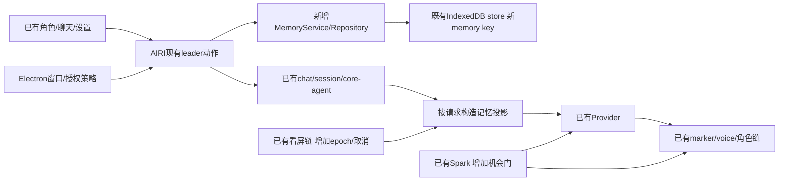

# 技术设计：单一AIRI运行时中的增量

日期：2026-10-14。状态：技术提案v1，可评审，未冻结/未实施。来源：当前AIRI v0.12.0-beta.5、候选源码、[阶段2补充核验](../../02-调研参考/2026-10-14-阶段2补充核验与覆盖.md)。用途：前后端实现边界、数据与失败处理。替代：R4旧SQLite/索引初稿和Smart Turn打断方案；不覆盖历史原文。风险：CAS为已安装库的离线模拟证据，真实IndexedDB/多窗口/重启仍需实施验证。

## 1. 架构选择建议

保持一套Electron主进程、Vue/Pinia、AIRI chat/session/core-agent、voice/audio、角色renderer与Provider。前端是已有stage-tamagotchi/stage-pages；“后端”是现有Electron main与本地数据/推理适配器，本期不另建HTTP/WS服务。

记忆建议使用**现有IndexedDB local挂载及同一底层store的新命名空间**，已有idb-keyval依赖提供单key事务更新。先做固定槽位+中文关键词/时间/重要性召回，不先上向量、图数据库、SQLite/Python sidecar。以后用同一接口替换索引，事实与来源仍是唯一权威。



决策理由：源码已表明聊天可靠提交、leader与持久化队列可复用；第二数据库增加来源一致性、删除、打包和迁移成本。现有unstorage普通get/set不是CAS或跨key事务，不能把“用了IndexedDB”当原子保证。采用窄MemoryRepo只写一个envelope的同步事务更新，并明确跨聊天删除是分步恢复。

## 2. 所有权与文件触点

以下相对`aimy-app/`，已有/拟新增明确区分。

| 责任 | 现有触点 | 增量边界 |
|---|---|---|
| 窗口、系统权限、采集授予 | `apps/stage-tamagotchi/src/main/windows/main/index.ts`、`src/main/index.ts`、已有screen-capture IPC | main发资源lease/撤权；renderer执行并回执；不新建窗口系统 |
| 唯一会话与提交 | `packages/stage-ui/src/stores/chat.ts`、`stores/chat/session-store.ts` | 新用户durable commit后排提取；编辑/删源/最终转写接失效屏障 |
| 请求上下文 | `packages/core-agent/src/runtime/chat-orchestrator-runtime.ts`、`stage-ui/src/stores/chat.ts` | 拟加通用request-scoped context resolver端口；不是把记忆塞全局registry |
| 记忆数据 | `stage-ui/src/database/storage.ts`、`database/repos/chat-sessions.repo.ts` | 拟新增`database/repos/memory.repo.ts`和`stores/memory/`，复用依赖/leader，repo独占memory key |
| 主动策略 | `stage-ui/src/stores/character/orchestrator/store.ts`、`packages/core-agent/src/agents/spark-notify` | 资格门、持久event状态、取消、先决定后呈现；不把timer变成假user发言 |
| 语音 | `stage-ui/src/stores/voice.ts`、`libs/voice/voice-activity-plugin.ts`、`core-agent/src/voice/input/attempt.ts`、`voice/output/response.ts` | 保留主链；先补全撤权/订阅，按实测选择onset或EOT实验 |
| 视觉 | `apps/stage-tamagotchi/src/renderer/composables/use-vision-screen-capture.ts`、`stage-ui/src/stores/modules/vision/` | 单产品owner、signal传递、epoch检查、清旧context；已有devtools也经过策略 |
| UI | `stage-pages/src/pages/settings/memory/index.vue`、`modules/vision.vue`、已有控制岛/聊天窗 | 填WIP与控制状态；不复制HTML预览状态机 |

当前`runtimeContextProviders`是无session参数的函数数组。新增记忆上下文必须按**本次请求的session/principal/character**构造，不可依赖“当前可见会话”，也不能污染全局ReplaceSelf桶。composedMessage只供hooks/devtools，改它不改变实际Provider请求；端口必须在真实Conversation投影前接入，实际调用前再验epoch。核验锚点：chat.ts:543–588、core runtime:741–759、881附近。

## 3. 数据与事务

### 3.1 存储建议

`MemoryEnvelopeV1`逻辑键：`local:aimy/memory/v1/{principalId}/{characterId}`。`airi-local`是local驱动的base/key前缀，不能称新建了一个名为airi-local的数据库；当前驱动默认使用idb-keyval的`keyval-store/keyval`。身份段先encodeURIComponent；当前物理key为`airi-local:aimy:memory:v1:{encodedPrincipal}:{encodedCharacter}`。转换由集中适配器与driver归一化测试，不能到处手拼。

```ts
// Proposed logical schema. All times are UTC epoch milliseconds.
type MemoryEnvelopeV1 = {
  schemaVersion: 1
  principalId: string; characterId: string
  revision: number; memoryEpoch: number
  ownerLease: { token: string; leaseUntil: number } | null
  facts: MemoryFact[]
  sourceStates: SourceState[]
  jobs: ExtractionJob[]
  barriers: ForgetBarrier[]
  proactiveEvents: ProactiveEvent[]
  recentMutations: MutationReceipt[]
}
type MemoryFact = {
  id: string; factKey: string
  kind: 'identity'|'preference'|'current-state'|'episode'|'boundary'
  text: string; status: 'active'|'superseded'
  revision: number; createdAt: number; updatedAt: number
  validUntil: number | null
  importance: 'normal'|'important'
  sources: Array<{sessionId:string;messageId:string;sourceRevision:number}>
  replacesId: string | null
}
```

principal由本地配置/既有用户作用域适配，不用UI传来的任意userId获得访问权；单角色仍校验character。登录/注销不悄悄合并本地与云身份。来源只保存消息引用/版本/必要摘要，事实与真实聊天不复制成第二份历史。

`SourceState`：session/message ID、sourceRevision、摘要hash、logicalOrigin、deleted/suppressed、提取游标。`ExtractionJob`：jobId、scope、sources版本、capturedEpoch、status、attempt、leaseToken、leaseUntil、promptVersion、模型版本、到期时间。`ForgetBarrier`：稳定factKey/已知source/派生lineage与epoch，**不保存被删正文**。`ProactiveEvent`：eventId/version、factIds/sourceRevision、scheduled/generating/presenting/presented/cancelled/failed、expiresAt、presentationReceipt；不存裸音频。

### 3.2 单key CAS与leader

- MemoryRepo独占此key；不与unstorage普通setItem混写。当前chat-session.persistQueue为私有队列，不能假定可直接导入；新增MemoryService串行命令队列，复用既有synced leader选举/动作转发。
- 已有`idb-keyval.update`在一个readwrite事务内读取、同步计算、put，并等待事务完成；回调不能await模型、网络或其他异步工作。
- 更新先比较expectedRevision、memoryEpoch、owner/job token；不一致返回原对象并记CONFLICT/STALE，不抛出复杂异步异常。只有事务完成才能返回committed；Quota/abort必须失败，不能发送“已保存”。
- leader只是运行owner，持久token与CAS才约束旧owner。每次claim/接管生成新leaseToken；旧模型结果即使回来，也不能在新token下提交。只用内存mutex不足以防窗口/重启竞态。
- CAS失败不合并陈旧全量快照；重新读取、重新确认用户意图，再形成局部命令。调用重试复用mutationId；相同ID不同payload报IDEMPOTENCY_MISMATCH。
- envelope先做小规模容量门，建议上限5000条/2MiB（**实验初值**）；容量门只限制新增事实/任务，删除与清理优先保留空间；达到上限停止新增并提示，不自动删旧事实。大量数据或迁移需求再评估事务型多表存储，不先承诺无限记忆。

### 3.3 提取与召回

durable user commit → enqueue job（同source版本去重）→ claim → 读取最新有效本人源 → 模型提候选 → schema与证据校验 → CAS再次核对epoch/source/revision/token → 原子提交facts和job终态。

只消费真实user文字/最终转写；assistant、system-trigger、工具内容与临时观察不进入本人事实提取。重试/导入/语音转写变化都用来源版本和血缘；不能只挂onChatTurnComplete遗漏晚到文字或把同一发言抽多次。默认不全库回放历史；如做补抽取，必须在同一屏障规则下有界执行。

固定槽位（称呼/边界等）直接读当前active版本；其他按中文短片段、事件时间和重要性组合，保留整条事实，不按字符截断成半句话。建议每次最多6条/1200字（初值），相关性不足返回空。无模型/关键词无结果仍能读取固定信息。索引是派生物，可重建；先没有向量库就不宣称语义召回解决。

投影携带memoryRevision、factIds/source IDs、有效时间；请求绑定scope/turn/signal。删除/纠正可取消引用受影响fact的在飞输出，不能等到下一轮才生效；source丢失默认不用于事实生成。

### 3.4 纠正、删除与恢复

纠正以明确用户更正为权威，稳定factKey上新版本替代旧版本；有效现状按来源时间/版本，非“最后返回的模型赢”。关系/权限/任务完成状态不由LLM自由赋值。

删记忆先在同一次envelope CAS：增加epoch、删正文、作废相关job/event/投影，保存最小屏障；再清理派生缓存。选择同时删来源时，**先持久屏障，再走原chat删除**。跨key无法同事务：中途失败返回PARTIAL_DELETE；不可变barrierReceipt与可变cleanupState分离，同mutation重试先查身份再检查revision，只恢复同一cleanup job，不重复推进屏障；operation.get可查询最新状态，重启根据屏障继续清理；删除动作在清理重试期间已禁止旧来源重抽取。

原聊天编辑/删除同样先使来源版本失效，再修改chat。来源无法确认/变更尚未提交时，不发布新的事实。压缩历史/缓存必须带lineage；当前未建立lineage的摘要，受影响后整份作废并从过滤后有效历史重建。原版默认compaction仅有移除回合计数；含旧事实的摘要风险针对定制formatter/未来摘要，不能谎称原版已自动生成秘密摘要。prompt历史投影剔除被抑制的已知来源及相关回合/派生，防“库删了但同轮旧上下文还在”。**本地native continuation、providerTranscript、generationTranscript也在此范围**：受影响turn删除/重建这些派生重放数据；opaque数据无可证lineage时保守作废。现有matching-scope会直接重放（chat-completions.ts:178、runtime/responses.ts:83），当前scope不含memoryEpoch（runtime/request-context.ts:47）；拟将contextEpoch绑定memoryEpoch，旧scope失配后走过滤后的portable投影，发送前再次校验guard。不得仅改message.content或UI。这是本地请求保护，不声称删除供应商远端日志。

删除保证限定于已知来源/同scope/派生链。未知同义历史、另一个Provider保存的数据和用户之后重新说的新事实不可能靠删一行保证全世界擦除。UI显示范围；显式恢复/重新授权是新版本意图，不因后台任务自行解除屏障。需覆盖稳定槽位更名、同义来源和人工删除的产品判例，不能宣传绝对语义遗忘。

重启先恢复屏障与schema，再恢复事实和待处理job；到期任务不补发一串问候。claim旧lease只能过期后有界重试；写失败保持旧完整envelope，不清pending后再写。新进程用同data目录验证，不用同内存读回代替持久化。

## 4. 生命周期、权限与本地优先

main拥有可见/最小化/锁屏/退出的资源策略，mic与screen独立epoch/lease。所有采集入口包括设备hold、电平、连续聆听、单条录音、devtools和ambient消费者都必须受同一产品策略；调用voice.stopListening不等于释放audio-device hold。

撤权顺序：同步deny+epoch递增 → 停timer/拒新请求 → abort模型/ASR/读队列 → 停track/清video/frame/context → 停相关播放/动作 → 有限本地回执。授权晚到stream先检查token，失效立即停track；UI关闭不等远端响应。远端不支持取消时仍拒交付，但不能承诺计费已停。

收起聊天保留角色及已有有效授权；隐藏主角色/最小化/锁屏/睡眠/退出停感知和自动输出。恢复显示仍暂停，用户手动重开（建议默认）。普通失焦不撤权，仍可陪伴；原生生命周期不能简单套网页visibilitychange。

当前源码登录后Provider完整config自动PUT、非local聊天outbox/WS可发送。P0要在**实际发送入口**默认禁止未同意的同步，不只关角色卡flag或隐藏登录按钮。旧outbox冻结、保留本地，不启动发送；本轮不清空用户现有数据，也不声称已发生上传。

凭据方案建议使用既有Electron main内的safeStorage能力建立窄secret桥：存密文/引用，普通配置和同步快照只存secretRef；模型请求在授权调用边界解析，必要临时明文不进入Pinia持久化/跨窗口全量同步/日志。具体Provider是否必须renderer调用需逐消费者适配；若无法隔离，先选单次会话内存密钥模式，不能明文落盘作后备。加密可用性/旧配置迁移/删除/测试失败单列验收，不宣称已存在该保险库。

## 5. 主动陪伴

机会门先检查可见、主动开关、非安静、无用户输入/回复进行中、有效记忆/新鲜观察、冷却、event去重和预算。任何不满足直接沉默，不每个tick调用模型。

本期采用**先决定、后呈现**：主动模型返回完整say/silence结构，经校验后才送既有文本/语音/动作链。Spark当前no-response不能撤回早前已发sink的delta，forceTextResponse也会关闭no-response；须窄适配policy/sink，禁止外部command/tool并贯穿AbortSignal。不能仅写一句Prompt后继续流式播报。

system-trigger不是用户发言；不调用chat.send('主动说点什么')。事件经现有Agent/Provider产生assistant-only提交，metadata带origin=proactive/eventId/version。scheduled/inflight/presented都按eventId/version去重；锁在首个await前获取。用户开始说/打字、换会话、删事实、关闭/隐藏均撤销旧代次。

持久去重在发声前写presenting，回执后写presented。**崩溃时无法跨数据库与扬声器实现恰好一次**：presenting未知结果恢复为uncertain，不自动补播；宁可漏一次轻主动，避免重复打扰。用户可见回执区分生成、已开始、完成、被打断和失败；不能把整句排队当已经听完。

## 6. 视觉和语音

视觉沿已有single-flight/skip-busy与推理队列，新增product单owner、screenEpoch/source/session绑定、signal传入runVisionInference和await后发布检查。临时ReplaceSelf只属于当前scope/source，新帧替换旧帧；停/换源/过期移除。图片附件不是持续录屏，不误被全局screen停止删除。

建议间隔30/60/180秒、默认60秒；目前UI范围500–15000ms需有界适配，而非声称这些长间隔已有。采集、推理、开口分频；推理前预留预算/并发位，失败/取消也记attempt，未知Token不当0费用。预算owner按reserved→started→settled记账：未发网络的reservation取消可释放，已started的取消/迟到不退调用额度；stale仅不得改当前epoch结果展示，不能删预算审计。上限用滚动1小时/24小时窗口，started时间戳与policy持久化，重启不重置；UI显示下一项额度到期时间。预算无法估价时用调用上限，达到即暂停。

语音沿AIRI onset→reserve pre-roll→interrupt→silence receipt→ASR/submit，输入与输出不是互斥的一个idle状态。先真实测；只有证实误打断才加onset候选门。若额外确认240ms仍要360ms预录，history需覆盖确认+pre-roll+调度余量，按实际PCM首尾坐标测试。

**Smart Turn仅是可选EOT（说完）实验**，接`attempt.detectEnd`，不能作为“等用户说完才停她”的打断条件。固定模型/SHA/预处理，speech/transcript/context revision失效时旧end无效；现有voice-activity-plugin静音1200ms直接input.end也须纳入同一个终点协调者，否则会与Smart Turn的continue竞争；超时回到静音基线。未经设备与中文语料验证不列必选。

文本、朗读、ACT是同turn的投影。保留marker流/合法强度；朗读规范化不删显示正文，坏动作不执行。取消要停producer/播放并拒晚到音频/文本/动作，不能只清UI队列。

## 7. 迁移、诊断与回滚

新增namespace初版不导入旧样机、候选SQLite/JSON/向量数据；旧聊天只读作为来源。schema迁移先备份可恢复快照、校验scope、写新版本再切指针；失败保持旧可读且关闭自动写。不能让回滚重新启用已删除的旧事实：屏障高版本必须保留，旧实现不理解则只读拒写。

诊断默认只存operation ID、版本、阶段耗时、Token/调用、错误码、取消/拒迟到计数；无凭据/原截图/原录音。内容调试另开用户明确授权与到期删除，不复用候选原日志。

按批次功能开关回滚到AIRI原链：记忆/主动/视觉增量分别关；已有会话保持可用。不能通过删除整个userData或旧库来“修复”。来源与许可证随复用片段登记，主工程包名、IPC、数据库名与版权不大改。

补充数据语义：MemoryFact.status维护active/superseded；viewStatus计算current/expired/unknown。过期事件没有完成证据只标unknown，不由到期计时器写成done。MemoryRepo直接update不会触发unstorage watch，UI镜像只依赖提交回执和带revision的失效广播，接任者重新load。

本轮功能复核补注：AIRI已有processNarrative，当前默认消费接线未启用；不需要为叙事过滤引入OLV第二算法。模型输出source ID有效只能校验引用存在，不能确定性证明本人/否定语义蕴含；自动记忆准确率需真实模型评测，当前候选反例不得写成已被所有代码规则解决。Ryza完整原文预算不采纳，Aimy整条装箱是自建要求，不冒称复用了成熟实现。

AIRI内部复用补注：services/computer-use-mcp/src/task-memory已有schema更新输入、scalar/list合并、精确去重、条数限额、sourceTurnIndex陈旧水位与上下文格式。MEM/SRC实施前优先审用这些纯叶子；不能原样继承其内存/clear/append语义当事实仓库，也不为它们启整个电脑操作服务。缺持久事实/逐条来源/删除屏障/CAS/检索的具体边界见新补核。若提取共享模块，另列精准文件/接口，不自动扩大当前允许区。

## 离线同条件验证后的实施提醒

[最新原代码对照](../../02-调研参考/2026-10-14-长期记忆召回与主动续聊同条件验证.md)确认：AIRI真实IDB能保聊天，不能当事实仓已完成；Aions精确主题替换、来源复查和持久计划有局部价值，但换topic删除屏障/最终取消不完备；Ryza原更正与在飞删除真实localStorage仍有反例。先复用AIRI纯规则与已有owner，逐事实revision/稳定key、current与historical分流、无关拒回/整条预算和最终提交前session/epoch门仍由本期增量实现。尚未实施，不能把1200/5目标写成候选原生承诺。
